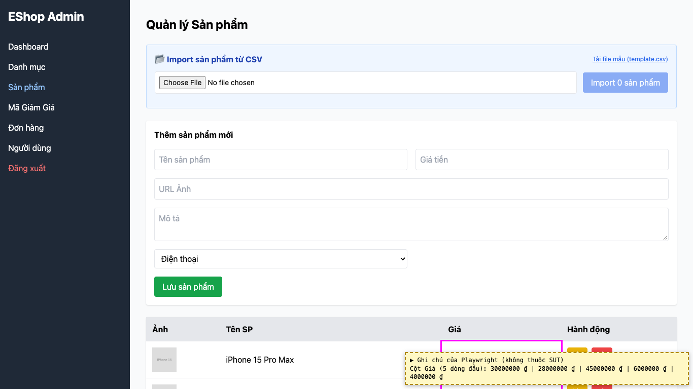
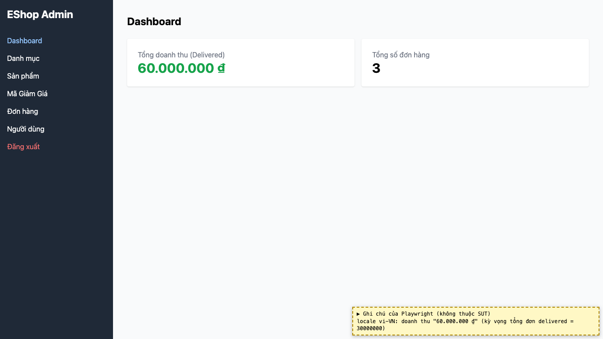
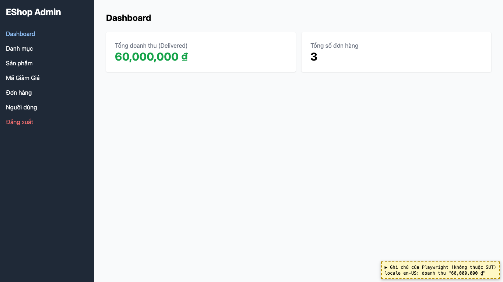
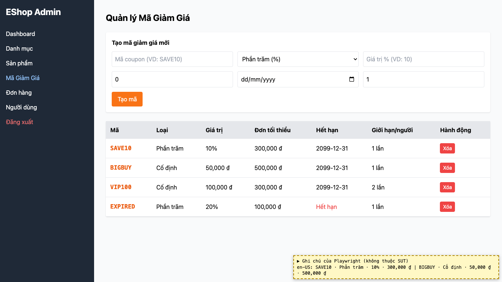

# BUG-19: [Sản phẩm, Dashboard, Mã giảm giá] Số tiền không theo định dạng vi-VN thống nhất

| Trường | Giá trị |
|---|---|
| GitHub Issue | [#136](https://github.com/Taylor3691/eshop-sut/issues/136) |
| Nguồn phát hiện | Checklist GUI-01-09, GUI-01-10 |
| Màn hình | Quản lý Sản phẩm, Dashboard, Quản lý Mã giảm giá |
| Môi trường | macOS 27.2, Google Chrome 157.0.8103.51 (Playwright, headless), http://localhost:5174 |
| Severity | Minor — giá khó đọc, định dạng khác nhau giữa các màn |
| Priority | Medium |
| Tham chiếu spec | FR-21, giải đáp 11 |

**Điều kiện tiên quyết:** SUT chạy bằng `scripts/start-sut.sh` (+ `scripts/seed-hw03.sh 3`); đăng nhập Web Admin bằng `admin@eshop.com` / `Admin123!`.

**Bước tái hiện:**
1. Tab Sản phẩm: xem cột Giá.
2. Đặt ngôn ngữ trình duyệt là English (US), tải lại, xem Dashboard và bảng Mã giảm giá.

**Kết quả mong đợi:** FR-21: luôn dùng ký hiệu ₫ với định dạng phân cách hàng nghìn. Giải đáp 11: định dạng vi-VN `1.234.567 ₫`, thống nhất giữa các màn.

**Kết quả thực tế:** Cột Giá in thô "30000000 ₫" (không phân cách). Dashboard và bảng Mã giảm giá đổi theo ngôn ngữ trình duyệt: vi-VN "60.000.000 ₫", en-US "60,000,000 ₫".

**Ảnh chụp:**

