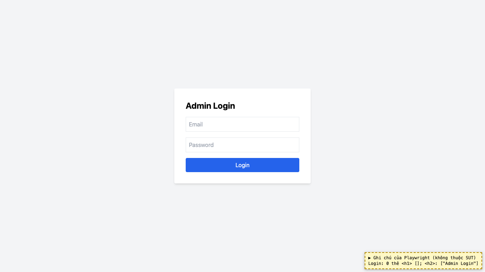
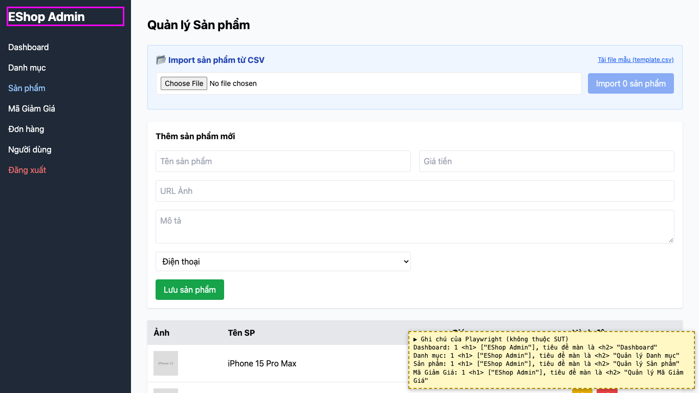

# BUG-20: [Nhiều màn hình] Các màn không có thẻ `<h1>` mô tả nội dung riêng

| Trường | Giá trị |
|---|---|
| GitHub Issue | Chưa tạo |
| Nguồn phát hiện | Checklist GUI-01-01 |
| Màn hình | Admin Login, Dashboard, Quản lý Danh mục, Quản lý Sản phẩm, Quản lý Mã giảm giá |
| Môi trường | macOS 27.2, Google Chrome 157.0.8103.51 (Playwright, headless), http://localhost:5174 |
| Severity | Minor — cấu trúc tiêu đề sai, ảnh hưởng trình đọc màn hình |
| Priority | Low |
| Tham chiếu spec | FR-21, giải đáp 1 |

**Điều kiện tiên quyết:** SUT chạy bằng `scripts/start-sut.sh` (+ `scripts/seed-hw03.sh 3`); đăng nhập Web Admin bằng `admin@eshop.com` / `Admin123!`.

**Bước tái hiện:**
1. Mở màn Login, đếm thẻ `<h1>` (DevTools: `document.querySelectorAll('h1')`).
2. Đăng nhập, lặp lại ở 4 tab.

**Kết quả mong đợi:** FR-21 / giải đáp 1: mỗi màn hình, kể cả Login, có đúng một `<h1>` mô tả nội dung màn đó.

**Kết quả thực tế:** Login không có `<h1>` (tiêu đề "Admin Login" là `<h2>`). Cả 4 tab dùng chung `<h1>` "EShop Admin" ở sidebar; tên màn hình nằm ở `<h2>`.

**Ảnh chụp:**

