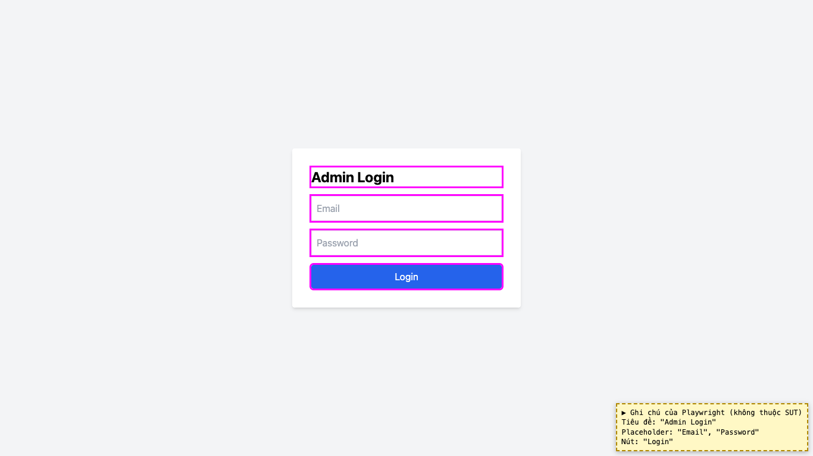
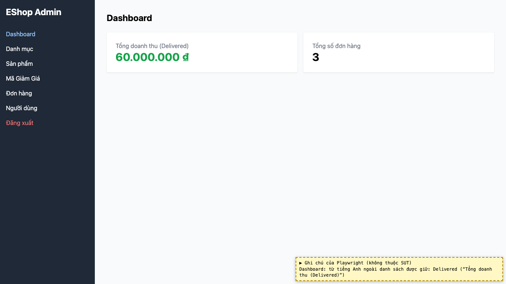
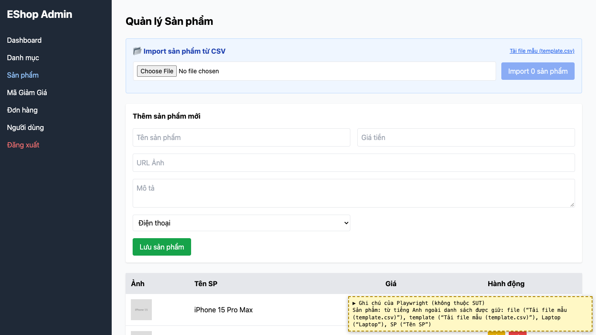
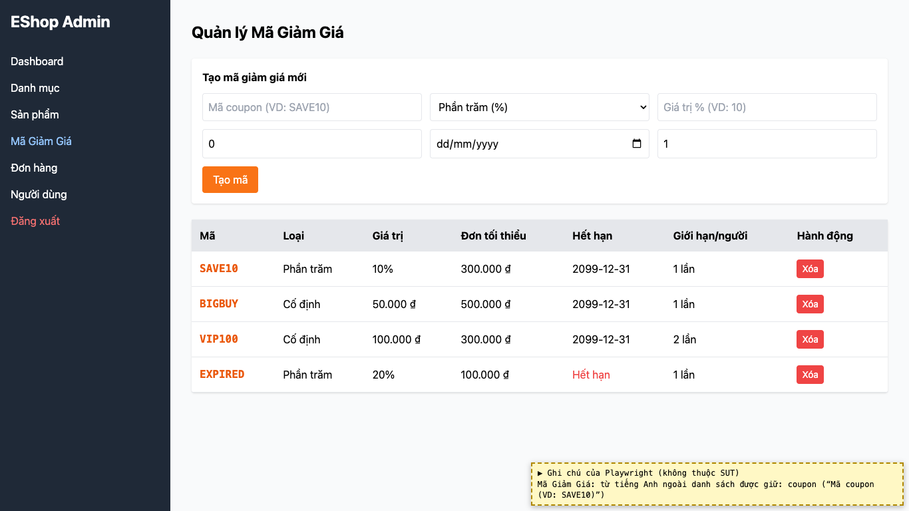

# BUG-21: [Nhiều màn hình] Còn chữ tiếng Anh và viết tắt trên giao diện

| Trường | Giá trị |
|---|---|
| GitHub Issue | Chưa tạo |
| Nguồn phát hiện | Checklist GUI-01-02, GUI-01-03 |
| Màn hình | Admin Login, Dashboard, Quản lý Sản phẩm, Quản lý Mã giảm giá |
| Môi trường | macOS 27.2, Google Chrome 157.0.8103.51 (Playwright, headless), http://localhost:5174 |
| Severity | Minor — không nhất quán ngôn ngữ |
| Priority | Low |
| Tham chiếu spec | FR-21, giải đáp 2 |

**Điều kiện tiên quyết:** SUT chạy bằng `scripts/start-sut.sh` (+ `scripts/seed-hw03.sh 3`); đăng nhập Web Admin bằng `admin@eshop.com` / `Admin123!`.

**Bước tái hiện:**
1. Mở màn Login, rồi lần lượt các tab Dashboard, Sản phẩm, Mã Giảm Giá; đọc tiêu đề, nhãn, nút, placeholder.

**Kết quả mong đợi:** FR-21 / giải đáp 2: toàn bộ giao diện dùng tiếng Việt; chỉ giữ Dashboard, Admin, CSV, Import, URL, ID, Email; phải dịch Login → Đăng nhập, Password → Mật khẩu, Delivered → Đã giao.

**Kết quả thực tế:** Login: "Admin Login", placeholder "Password", nút "Login". Dashboard: "Tổng doanh thu (Delivered)". Sản phẩm: "Tải file mẫu (template.csv)", cột "Tên SP" (viết tắt). Mã giảm giá: placeholder "Mã coupon (VD: SAVE10)".

**Ảnh chụp:**

