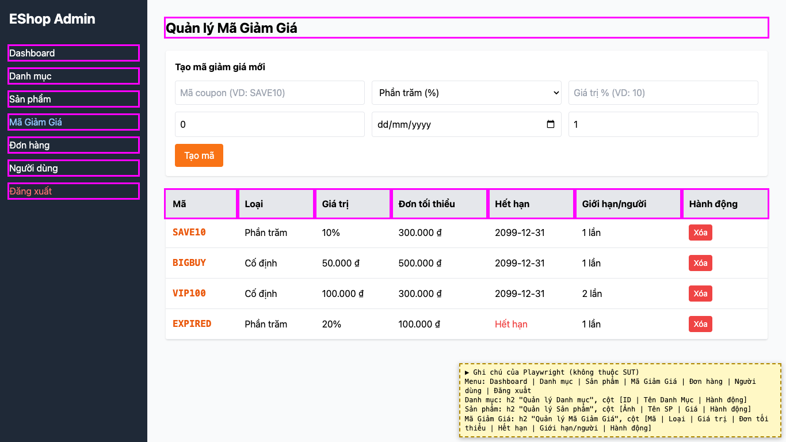

# BUG-22: [Nhiều màn hình] Cách viết hoa không thống nhất giữa menu, tiêu đề và cột bảng

| Trường | Giá trị |
|---|---|
| GitHub Issue | Chưa tạo |
| Nguồn phát hiện | Checklist GUI-01-05 |
| Màn hình | Sidebar, Quản lý Danh mục, Quản lý Mã giảm giá |
| Môi trường | macOS 27.2, Google Chrome 157.0.8103.51 (Playwright, headless), http://localhost:5174 |
| Severity | Trivial — chỉ ảnh hưởng thẩm mỹ |
| Priority | Low |
| Tham chiếu spec | BP Nielsen #4 |

**Điều kiện tiên quyết:** SUT chạy bằng `scripts/start-sut.sh` (+ `scripts/seed-hw03.sh 3`); đăng nhập Web Admin bằng `admin@eshop.com` / `Admin123!`.

**Bước tái hiện:**
1. Đăng nhập, xem sidebar, tiêu đề màn và tiêu đề cột ở các tab Danh mục, Sản phẩm, Mã Giảm Giá.

**Kết quả mong đợi:** BP Nielsen #4: cùng một kiểu viết hoa (chỉ viết hoa chữ đầu), ví dụ "Mã giảm giá", "Tên danh mục".

**Kết quả thực tế:** Trộn kiểu: "Mã Giảm Giá", "Quản lý Mã Giảm Giá", "Tên Danh Mục" bên cạnh "Danh mục", "Quản lý Sản phẩm", "Tên SP".

**Ảnh chụp:**

