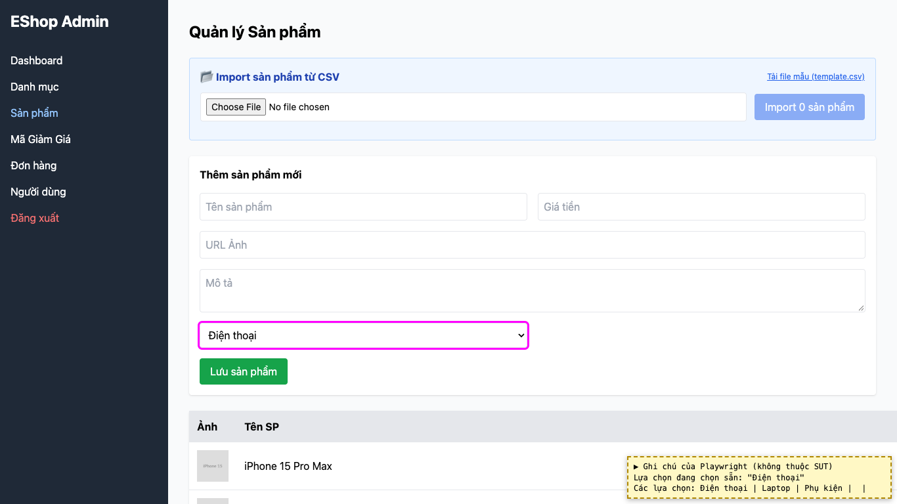

# BUG-23: [Quản lý Sản phẩm] Ô chọn danh mục không có lựa chọn gợi ý, mặc định chọn sẵn danh mục đầu

| Trường | Giá trị |
|---|---|
| GitHub Issue | [#140](https://github.com/Taylor3691/eshop-sut/issues/140) |
| Nguồn phát hiện | Checklist GUI-02-14 |
| Màn hình | Quản lý Sản phẩm |
| Môi trường | macOS 27.2, Google Chrome 157.0.8103.51 (Playwright, headless), http://localhost:5174 |
| Severity | Minor — người dùng dễ lưu sản phẩm vào nhầm danh mục |
| Priority | Low |
| Tham chiếu spec | FR-15 |

**Điều kiện tiên quyết:** SUT chạy bằng `scripts/start-sut.sh` (+ `scripts/seed-hw03.sh 3`); đăng nhập Web Admin bằng `admin@eshop.com` / `Admin123!`.

**Bước tái hiện:**
1. Tab Sản phẩm, xem ô chọn danh mục ở form "Thêm sản phẩm mới".

**Kết quả mong đợi:** FR-15: danh mục bắt buộc, phải chọn từ danh sách có sẵn; form thêm mới có lựa chọn gợi ý "-- Chọn danh mục --" và chặn gửi khi chưa chọn.

**Kết quả thực tế:** Ô chọn sẵn "Điện thoại" (`category_id` mặc định 1), không có lựa chọn gợi ý nên không thể "chưa chọn".

**Ảnh chụp:**

