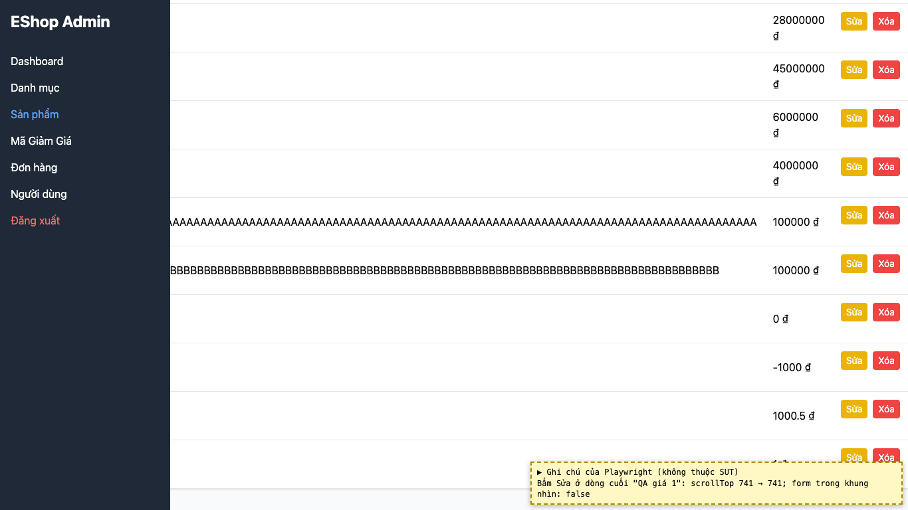
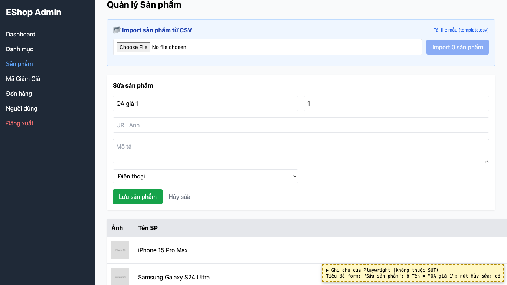

# BUG-24: [Quản lý Sản phẩm] Bấm "Sửa" không đưa người dùng tới form sửa

| Trường | Giá trị |
|---|---|
| GitHub Issue | Chưa tạo |
| Nguồn phát hiện | Checklist GUI-02-15 |
| Màn hình | Quản lý Sản phẩm |
| Môi trường | macOS 27.2, Google Chrome 157.0.8103.51 (Playwright, headless), http://localhost:5174 |
| Severity | Minor — người dùng không thấy form đã chuyển sang chế độ sửa |
| Priority | Medium |
| Tham chiếu spec | Giải đáp 13 |

**Điều kiện tiên quyết:** SUT chạy bằng `scripts/start-sut.sh` (+ `scripts/seed-hw03.sh 3`); đăng nhập Web Admin bằng `admin@eshop.com` / `Admin123!`.

**Bước tái hiện:**
1. Tab Sản phẩm có nhiều sản phẩm, cuộn xuống cuối bảng.
2. Bấm "Sửa" ở dòng cuối.

**Kết quả mong đợi:** Giải đáp 13: ở chế độ sửa, form phải thể hiện rõ đang sửa và tự cuộn lên form.

**Kết quả thực tế:** Trang không cuộn (scrollTop 741 → 741), form nằm ngoài khung nhìn. Khi tự cuộn lên thì tiêu đề "Sửa sản phẩm", dữ liệu và nút "Hủy sửa" đều đúng.

**Ảnh chụp:**

