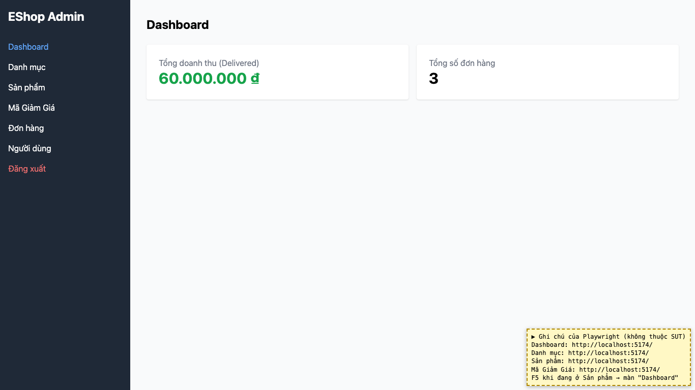
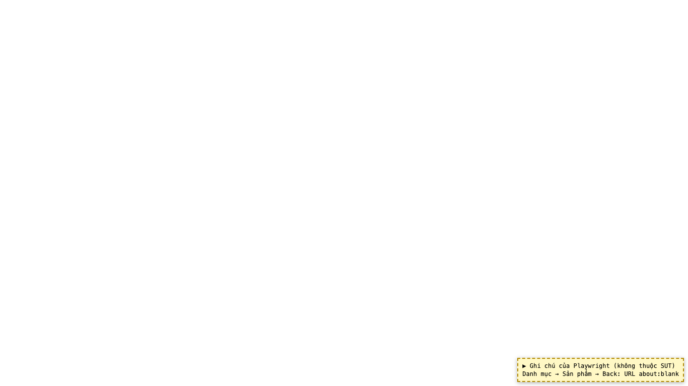

# BUG-25: [Nhiều màn hình] Các tab không có URL riêng: F5 về Dashboard, Back rời khỏi ứng dụng

| Trường | Giá trị |
|---|---|
| GitHub Issue | Chưa tạo |
| Nguồn phát hiện | Checklist GUI-03-06 |
| Màn hình | Dashboard, Quản lý Danh mục, Quản lý Sản phẩm, Quản lý Mã giảm giá |
| Môi trường | macOS 27.2, Google Chrome 157.0.8103.51 (Playwright, headless), http://localhost:5174 |
| Severity | Minor — mất vị trí đang làm khi tải lại, nút Back không dùng được |
| Priority | Low |
| Tham chiếu spec | Giải đáp 1, BP Nielsen #3 |

**Điều kiện tiên quyết:** SUT chạy bằng `scripts/start-sut.sh` (+ `scripts/seed-hw03.sh 3`); đăng nhập Web Admin bằng `admin@eshop.com` / `Admin123!`.

**Bước tái hiện:**
1. Đăng nhập, mở tab Sản phẩm, xem URL; nhấn F5.
2. Mở Danh mục rồi Sản phẩm, bấm Back của trình duyệt.

**Kết quả mong đợi:** Giải đáp 1 (mỗi tab là một trang) và BP Nielsen #3: mỗi tab có URL riêng; F5 giữ nguyên tab; Back/Forward đi qua lại giữa các tab.

**Kết quả thực tế:** Mọi tab dùng chung URL `http://localhost:5174/`; F5 ở Sản phẩm quay về Dashboard; Back rời khỏi ứng dụng (about:blank trong lần chạy tự động).

**Ảnh chụp:**

