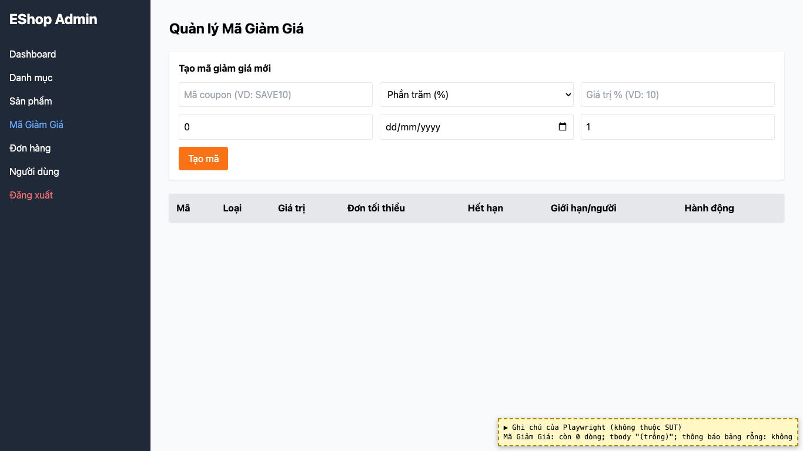
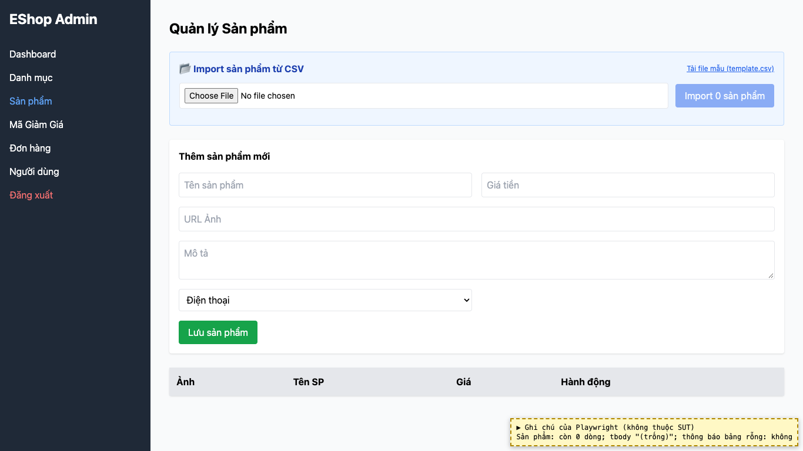
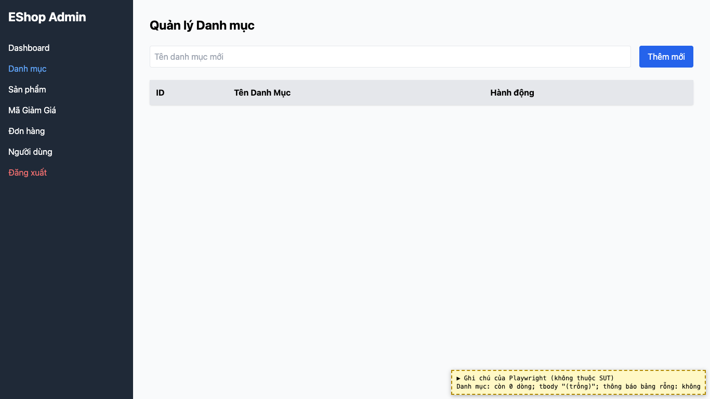

# BUG-26: [Danh mục, Sản phẩm, Mã giảm giá] Bảng rỗng không có thông báo trạng thái trống

| Trường | Giá trị |
|---|---|
| GitHub Issue | [#143](https://github.com/Taylor3691/eshop-sut/issues/143) |
| Nguồn phát hiện | Checklist GUI-04-08 |
| Màn hình | Quản lý Danh mục, Quản lý Sản phẩm, Quản lý Mã giảm giá |
| Môi trường | macOS 27.2, Google Chrome 157.0.8103.51 (Playwright, headless), http://localhost:5174 |
| Severity | Minor — người dùng không biết bảng rỗng hay chưa tải xong |
| Priority | Low |
| Tham chiếu spec | FR-24, giải đáp 7 |

**Điều kiện tiên quyết:** SUT chạy bằng `scripts/start-sut.sh` (+ `scripts/seed-hw03.sh 3`); đăng nhập Web Admin bằng `admin@eshop.com` / `Admin123!`.

**Bước tái hiện:**
1. Xóa hết dòng ở bảng Mã giảm giá, Sản phẩm, Danh mục.

**Kết quả mong đợi:** FR-24 / giải đáp 7: khi bảng rỗng phải hiện icon/hình minh họa và thông báo thân thiện.

**Kết quả thực tế:** Cả 3 bảng chỉ còn dòng header, không có thông báo nào.

**Ảnh chụp:**

