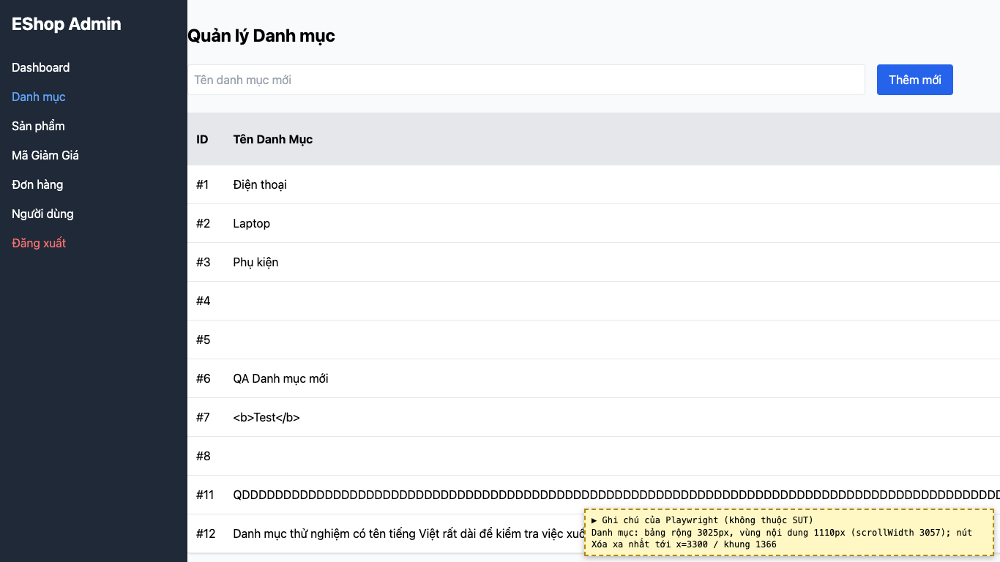
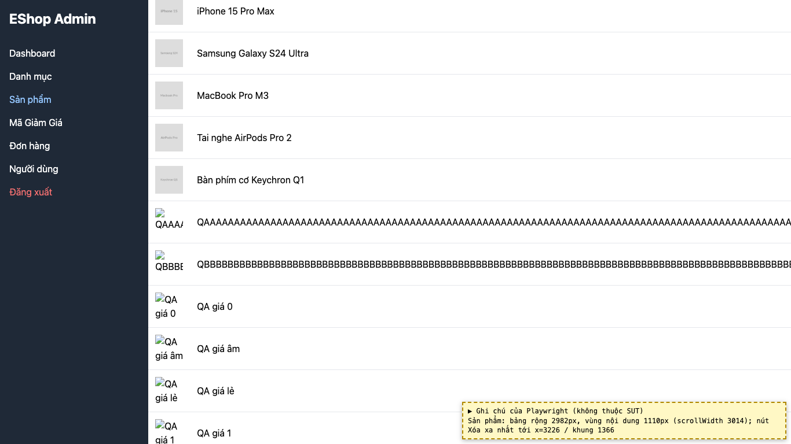

# BUG-27: [Danh mục, Sản phẩm] Tên dài không xuống dòng làm bảng tràn ngang, nút Xóa bị đẩy ra ngoài khung

| Trường | Giá trị |
|---|---|
| GitHub Issue | [#144](https://github.com/Taylor3691/eshop-sut/issues/144) |
| Nguồn phát hiện | Checklist GUI-01-20 |
| Màn hình | Quản lý Danh mục, Quản lý Sản phẩm |
| Môi trường | macOS 27.2, Google Chrome 157.0.8103.51 (Playwright, headless), http://localhost:5174 |
| Severity | Minor — phải cuộn ngang mới bấm được Sửa/Xóa |
| Priority | Low |
| Tham chiếu spec | BP |

**Điều kiện tiên quyết:** SUT chạy bằng `scripts/start-sut.sh` (+ `scripts/seed-hw03.sh 3`); đăng nhập Web Admin bằng `admin@eshop.com` / `Admin123!`.

**Bước tái hiện:**
1. Tạo danh mục và sản phẩm có tên 255 ký tự liền nhau (không có khoảng trắng).
2. Xem bảng Danh mục và bảng Sản phẩm.

**Kết quả mong đợi:** BP: dữ liệu dài phải xuống dòng hoặc bị cắt kèm "…", cột "Hành động" vẫn thấy và bấm được.

**Kết quả thực tế:** Bảng Danh mục rộng 3025px, bảng Sản phẩm 2982px trong vùng hiển thị 1110px; nút Xóa xa nhất ở x = 3300 / 3226 (khung 1366px).

**Ảnh chụp:**

