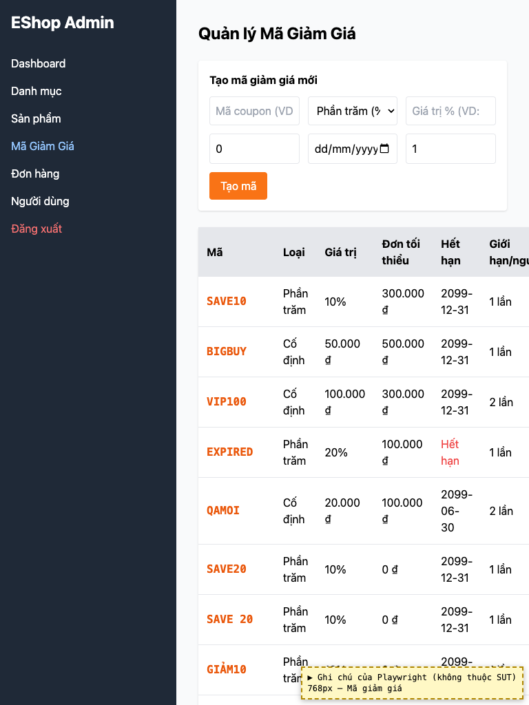
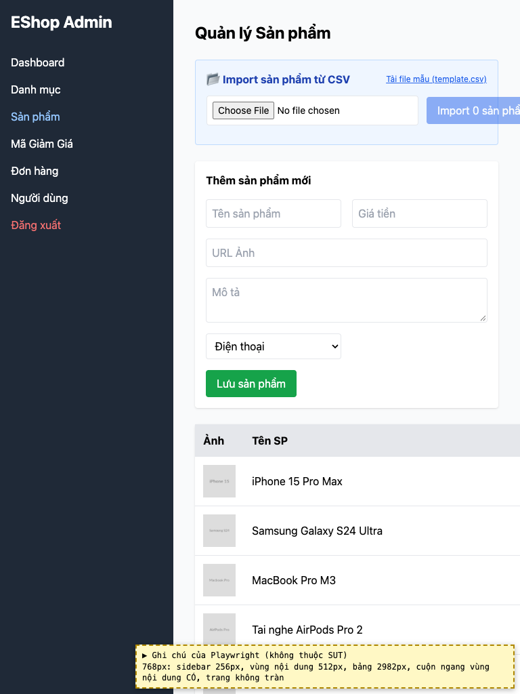
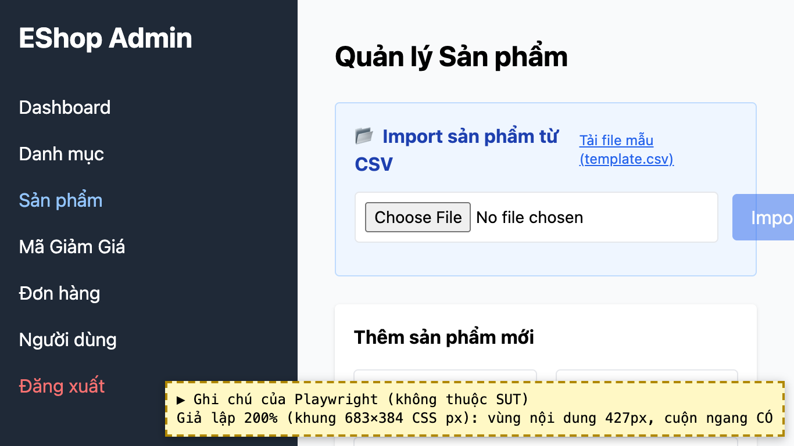

# BUG-28: [Nhiều màn hình] Bố cục không thích ứng với màn hình hẹp và khi phóng to 200%

| Trường | Giá trị |
|---|---|
| GitHub Issue | Chưa tạo |
| Nguồn phát hiện | Checklist GUI-01-15, GUI-01-16 |
| Màn hình | Quản lý Mã giảm giá, Quản lý Sản phẩm (và sidebar) |
| Môi trường | macOS 27.2, Google Chrome 157.0.8103.51 (Playwright, headless), http://localhost:5174 |
| Severity | Minor — một số cột và nút bị cắt, phải cuộn ngang |
| Priority | Low |
| Tham chiếu spec | BP (responsive), WCAG 1.4.4, 1.4.10 |

**Điều kiện tiên quyết:** SUT chạy bằng `scripts/start-sut.sh` (+ `scripts/seed-hw03.sh 3`); đăng nhập Web Admin bằng `admin@eshop.com` / `Admin123!`.

**Bước tái hiện:**
1. Thu cửa sổ còn 768px rộng, mở tab Mã Giảm Giá.
2. Ở 1366×768, phóng to 200% (Cmd +), mở tab Sản phẩm.

**Kết quả mong đợi:** BP: ở 768px và khi zoom 200%, bảng không tràn khỏi trang, form không bị cắt, không phải cuộn ngang để đọc.

**Kết quả thực tế:** 768px: sidebar cố định 256px, bảng Mã giảm giá bị cắt cột "Giới hạn/người" và "Hành động", placeholder bị cắt. Zoom 200% (giả lập): nút "Import…" bị cắt mép phải, phải cuộn ngang; sidebar chiếm hơn 1/3 bề ngang. Ghi chú: bảng Sản phẩm trong ảnh rộng bất thường do dữ liệu 255 ký tự (xem bug tên dài); zoom 200% là giả lập, nên kiểm lại bằng Cmd + trên Chrome thật.

**Ảnh chụp:**

