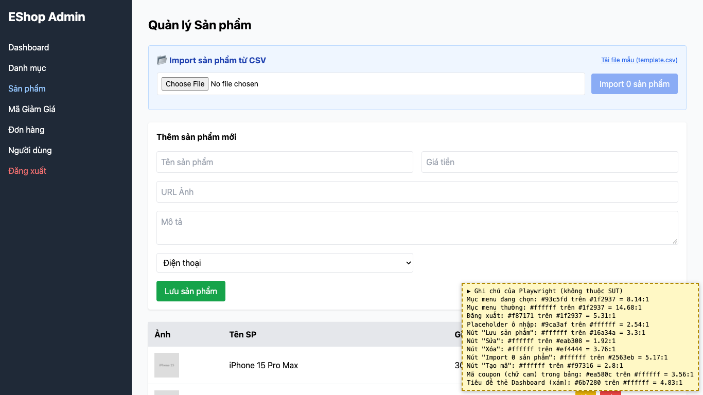

# BUG-29: [Nhiều màn hình] Độ tương phản chữ/nền dưới 4.5:1 ở placeholder và nhiều nút

| Trường | Giá trị |
|---|---|
| GitHub Issue | Chưa tạo |
| Nguồn phát hiện | Checklist GUI-01-19 |
| Màn hình | Quản lý Sản phẩm, Quản lý Mã giảm giá (và mọi form) |
| Môi trường | macOS 27.2, Google Chrome 157.0.8103.51 (Playwright, headless), http://localhost:5174 |
| Severity | Minor — khó đọc với người thị lực kém hoặc màn hình chói |
| Priority | Low |
| Tham chiếu spec | BP WCAG 1.4.3 |

**Điều kiện tiên quyết:** SUT chạy bằng `scripts/start-sut.sh` (+ `scripts/seed-hw03.sh 3`); đăng nhập Web Admin bằng `admin@eshop.com` / `Admin123!`.

**Bước tái hiện:**
1. Mở tab Sản phẩm và Mã Giảm Giá; đo độ tương phản bằng DevTools (Color picker → Contrast ratio).

**Kết quả mong đợi:** WCAG 1.4.3: độ tương phản chữ thường tối thiểu 4.5:1.

**Kết quả thực tế:** Dưới 4.5:1: nút "Sửa" (trắng trên #eab308) 1.92:1; placeholder (#9ca3af trên trắng) 2.54:1; nút "Tạo mã" (trắng trên #f97316) 2.8:1; nút "Lưu sản phẩm" (trắng trên #16a34a) 3.3:1; mã coupon chữ cam (#ea580c) 3.56:1; nút "Xóa" (trắng trên #ef4444) 3.76:1.

**Ảnh chụp:**

