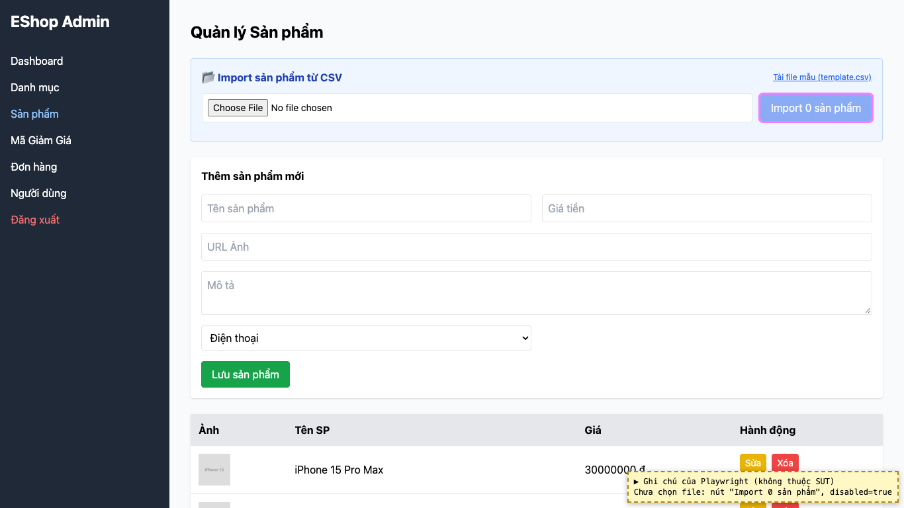

# BUG-30: [Quản lý Sản phẩm] Nút Import hiện "Import 0 sản phẩm" khi chưa chọn file

| Trường | Giá trị |
|---|---|
| GitHub Issue | Chưa tạo |
| Nguồn phát hiện | Checklist GUI-04-03 |
| Màn hình | Quản lý Sản phẩm (Import CSV) |
| Môi trường | macOS 27.2, Google Chrome 157.0.8103.51 (Playwright, headless), http://localhost:5174 |
| Severity | Trivial — nhãn gây hiểu nhầm, nút vẫn bị khóa đúng |
| Priority | Low |
| Tham chiếu spec | Giải đáp 8, BP |

**Điều kiện tiên quyết:** SUT chạy bằng `scripts/start-sut.sh` (+ `scripts/seed-hw03.sh 3`); đăng nhập Web Admin bằng `admin@eshop.com` / `Admin123!`.

**Bước tái hiện:**
1. Mở tab Sản phẩm, chưa chọn file, xem nút Import.

**Kết quả mong đợi:** Khi chưa chọn file, nút bị khóa và nhãn không gây hiểu lầm (ví dụ "Import" hoặc "Chọn file để import").

**Kết quả thực tế:** Nút bị khóa nhưng nhãn là "Import 0 sản phẩm".

**Ảnh chụp:**

