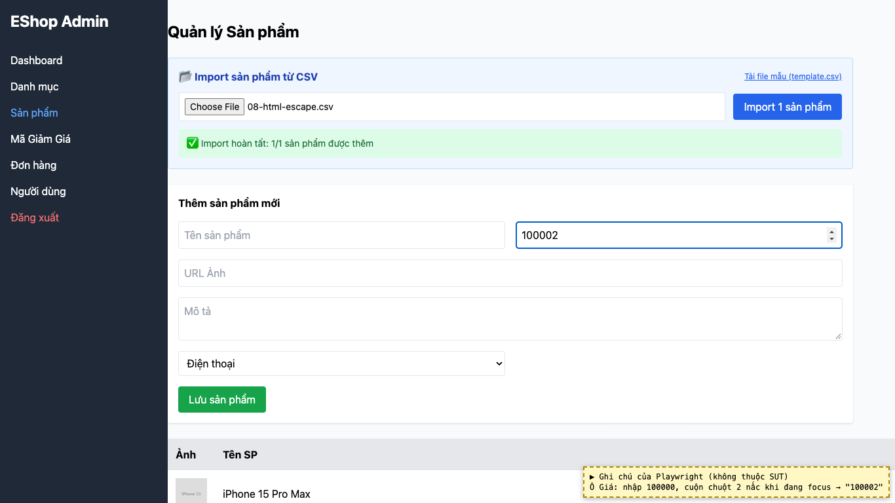
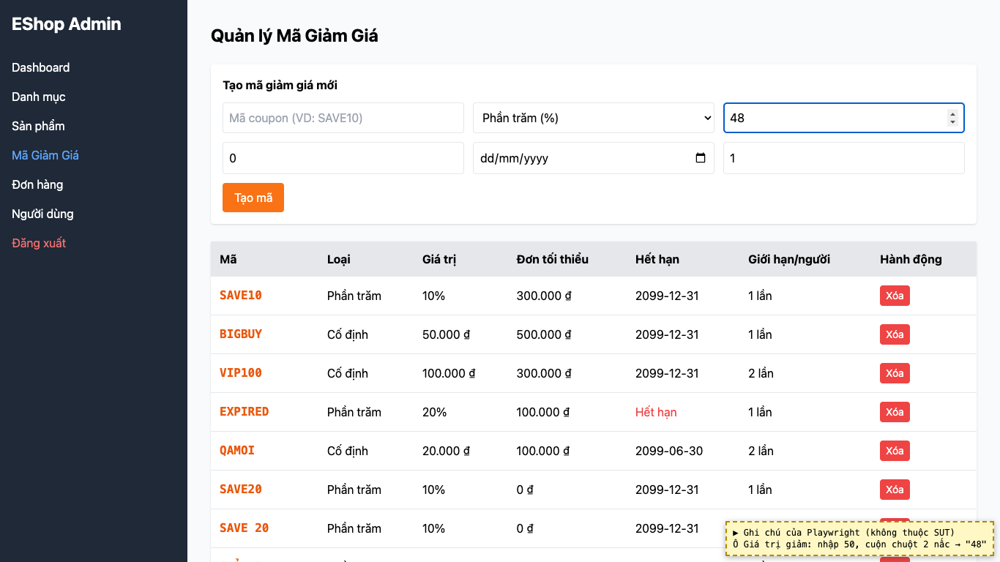

# BUG-31: [Sản phẩm, Mã giảm giá] Cuộn chuột trên ô số làm đổi giá trị đã nhập

| Trường | Giá trị |
|---|---|
| GitHub Issue | Chưa tạo |
| Nguồn phát hiện | Checklist GUI-02-24 |
| Màn hình | Quản lý Sản phẩm, Quản lý Mã giảm giá |
| Môi trường | macOS 27.2, Google Chrome 157.0.8103.51 (Playwright, headless), http://localhost:5174 |
| Severity | Minor — giá có thể bị đổi mà người dùng không để ý |
| Priority | Low |
| Tham chiếu spec | BP |

**Điều kiện tiên quyết:** SUT chạy bằng `scripts/start-sut.sh` (+ `scripts/seed-hw03.sh 3`); đăng nhập Web Admin bằng `admin@eshop.com` / `Admin123!`.

**Bước tái hiện:**
1. Tab Sản phẩm, bấm vào ô Giá, nhập 100000.
2. Giữ con trỏ trên ô, cuộn chuột lên 2 nấc.
3. Lặp lại ở ô Giá trị giảm (tab Mã Giảm Giá), cuộn xuống.

**Kết quả mong đợi:** BP: cuộn chuột không làm đổi giá trị ô số.

**Kết quả thực tế:** Ô Giá đổi 100000 → 100002; ô Giá trị giảm đổi 50 → 48. Ghi chú: quan sát bằng Playwright (headless), nên xác nhận lại bằng chuột thật.

**Ảnh chụp:**

