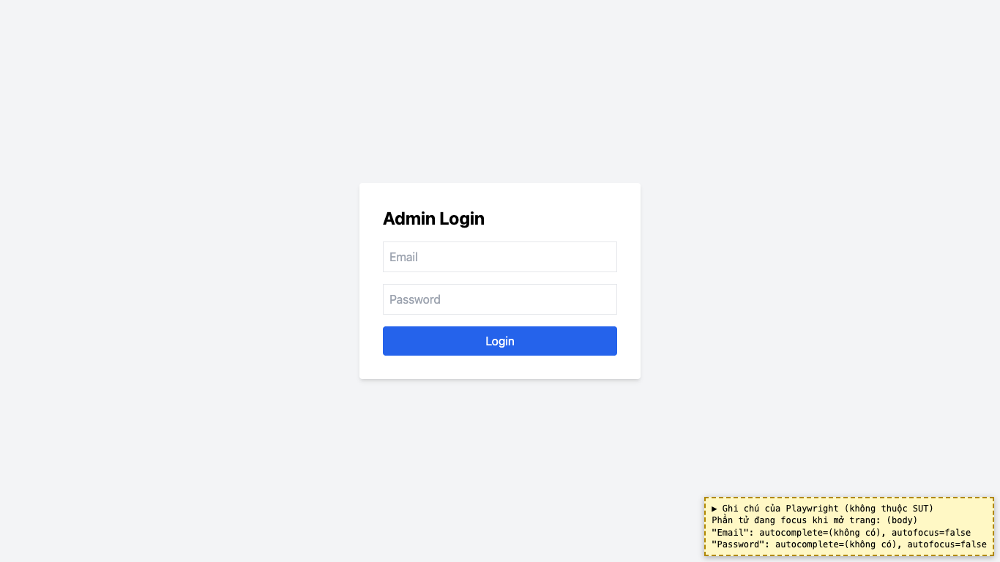

# BUG-32: [Admin Login] Không tự đặt con trỏ vào ô Email, không có autocomplete

| Trường | Giá trị |
|---|---|
| GitHub Issue | [#149](https://github.com/Taylor3691/eshop-sut/issues/149) |
| Nguồn phát hiện | Checklist GUI-02-25 |
| Màn hình | Admin Login |
| Môi trường | macOS 27.2, Google Chrome 157.0.8103.51 (Playwright, headless), http://localhost:5174 |
| Severity | Trivial — chậm thao tác, trình duyệt không gợi ý tài khoản |
| Priority | Low |
| Tham chiếu spec | BP WCAG 1.3.5 |

**Điều kiện tiên quyết:** SUT chạy bằng `scripts/start-sut.sh` (+ `scripts/seed-hw03.sh 3`); đăng nhập Web Admin bằng `admin@eshop.com` / `Admin123!`.

**Bước tái hiện:**
1. Mở http://localhost:5174 khi chưa đăng nhập.

**Kết quả mong đợi:** BP: con trỏ nằm sẵn ở ô Email; ô Email/Mật khẩu có `autocomplete="email"` / `"current-password"`.

**Kết quả thực tế:** Khi mở trang, focus ở `body`; hai ô không có thuộc tính `autocomplete` hay `autofocus`.

**Ảnh chụp:**

