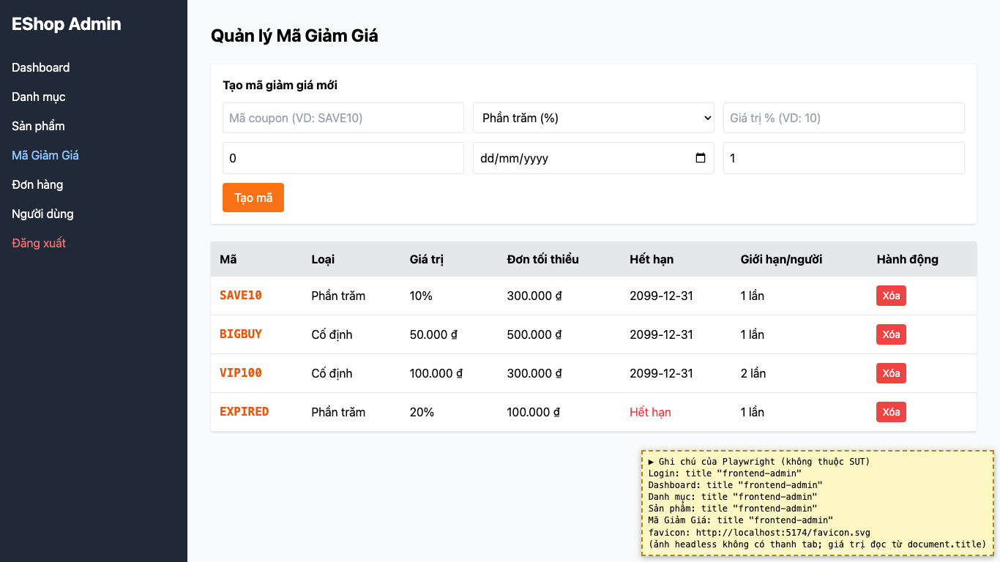

# BUG-33: [Nhiều màn hình] Tiêu đề tab trình duyệt luôn là "frontend-admin"

| Trường | Giá trị |
|---|---|
| GitHub Issue | [#150](https://github.com/Taylor3691/eshop-sut/issues/150) |
| Nguồn phát hiện | Checklist GUI-01-21 |
| Màn hình | Mọi màn hình |
| Môi trường | macOS 27.2, Google Chrome 157.0.8103.51 (Playwright, headless), http://localhost:5174 |
| Severity | Trivial — khó phân biệt tab, không mô tả nội dung |
| Priority | Low |
| Tham chiếu spec | BP WCAG 2.4.2 |

**Điều kiện tiên quyết:** SUT chạy bằng `scripts/start-sut.sh` (+ `scripts/seed-hw03.sh 3`); đăng nhập Web Admin bằng `admin@eshop.com` / `Admin123!`.

**Bước tái hiện:**
1. Mở màn Login rồi lần lượt 4 tab; xem tiêu đề tab trình duyệt và favicon.

**Kết quả mong đợi:** WCAG 2.4.2: tiêu đề trang mô tả màn đang mở (ví dụ "Quản lý sản phẩm – EShop Admin"); có favicon riêng.

**Kết quả thực tế:** Tiêu đề luôn là "frontend-admin" ở mọi màn; favicon là `favicon.svg` mặc định của Vite.

**Ảnh chụp:**

