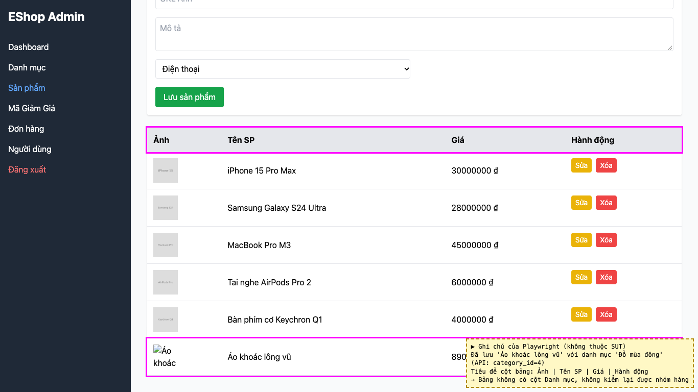

# BUG-34: [Quản lý Sản phẩm] Bảng sản phẩm không có cột danh mục, không kiểm lại được sản phẩm thuộc nhóm nào

| Trường | Giá trị |
|---|---|
| GitHub Issue | [#188](https://github.com/Taylor3691/eshop-sut/issues/188) |
| Nguồn phát hiện | Usability P1–P7 (nhóm I3 trong `task2-usability/analysis.md`) |
| Màn hình | Quản lý Sản phẩm |
| Môi trường | macOS 27.2, Google Chrome 157.0.8103.79 (Playwright, headless), http://localhost:5174 |
| Severity | Major — sản phẩm lưu sai danh mục không thể phát hiện trên giao diện; trong phiên usability P3 lưu sai mà không biết |
| Priority | Medium |
| Tham chiếu spec | FR-15 (Admin có thể Xem sản phẩm; danh mục là trường bắt buộc) |

**Điều kiện tiên quyết:** SUT chạy bằng `scripts/start-sut.sh` (+ `scripts/seed-hw03.sh 3`); đăng nhập Web Admin bằng `admin@eshop.com` / `Admin123!`.

**Bước tái hiện:**
1. Tab Danh mục: thêm danh mục "Đồ mùa đông".
2. Tab Sản phẩm: nhập Tên "Áo khoác lông vũ", Giá 890000, Mô tả bất kỳ, chọn danh mục "Đồ mùa đông", bấm "Lưu sản phẩm".
3. Xem bảng sản phẩm bên dưới form.

**Kết quả mong đợi:** FR-15: danh mục là thông tin bắt buộc của sản phẩm, nên màn hình xem sản phẩm phải cho biết mỗi sản phẩm thuộc danh mục nào. Sau khi lưu, người dùng kiểm lại được danh mục ngay trên bảng (Nielsen #1: hiển thị trạng thái hệ thống).

**Kết quả thực tế:** Bảng chỉ có các cột `Ảnh | Tên SP | Giá | Hành động`. API lưu đúng `category_id = 4` (Đồ mùa đông), nhưng giao diện không hiện danh mục ở đâu cả. Muốn biết sản phẩm thuộc nhóm nào thì chỉ có cách bấm "Sửa" rồi xem ô chọn.

**Bằng chứng từ đánh giá khả dụng (Task 2, 15/11/2026):**
- 7/7 người tham gia nói không kiểm lại được nhóm hàng trên bảng (P1 05:30, P4 03:50; câu probe C3 hoặc T1 của P2, P3, P4, P5, P6, P7).
- P3 để nguyên danh mục chọn sẵn "Điện thoại" (BUG-23) và lưu. Vì bảng không có cột danh mục nên P3 không phát hiện ra, bước B3 không đạt: *"Thấy tên áo và mã hiện lên thì em tưởng đã xong. Giờ em không chắc nhóm và điều kiện mã."* (P3 T1).
- *"Lưu rồi mà bảng không có cột danh mục, kiểm trên bảng không được."* (P4 03:50); *"Nhóm của áo không hiện lại, nên phần đó em kém chắc hơn."* (P7 T1).
- P4 và P7 đề xuất thêm cột danh mục (câu W1).

**Ảnh chụp:**

