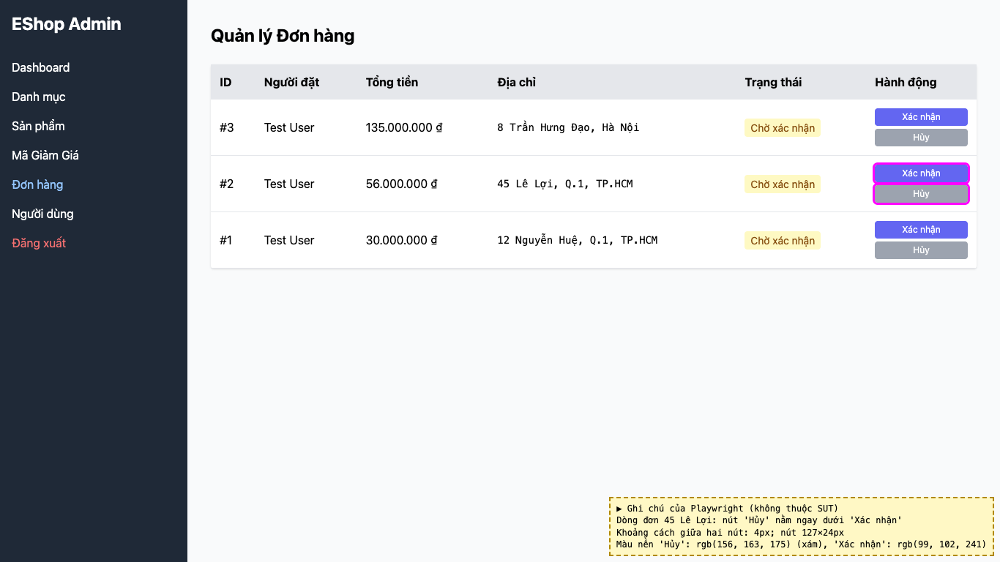
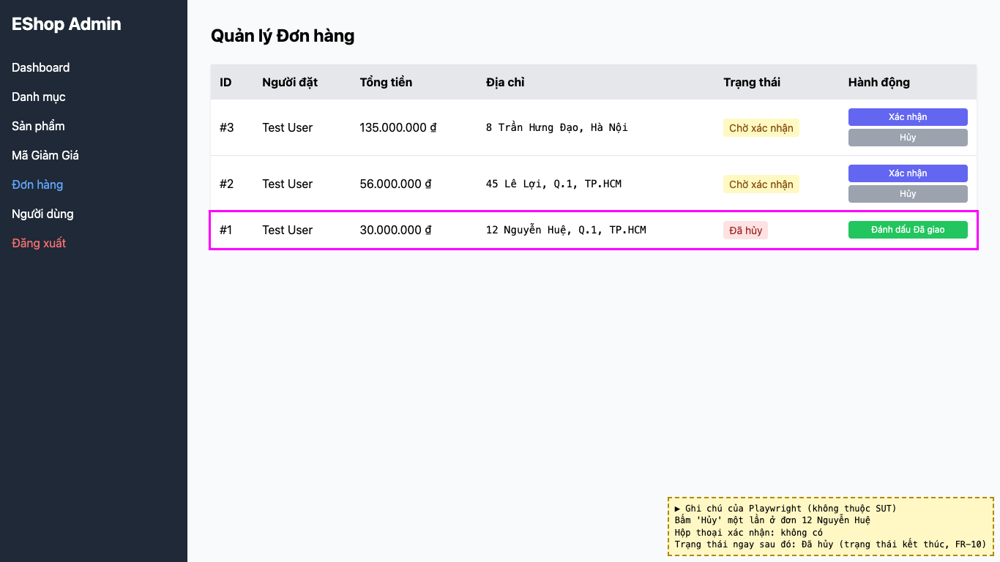

# BUG-35: [Quản lý Đơn hàng] Nút "Hủy" màu xám, nằm sát ngay dưới "Xác nhận" và hủy đơn ngay không hỏi lại

| Trường | Giá trị |
|---|---|
| GitHub Issue | #__ |
| Nguồn phát hiện | Usability P1–P7 (nhóm I6 trong `task2-usability/analysis.md`) |
| Màn hình | Quản lý Đơn hàng |
| Môi trường | macOS 27.2, Google Chrome 157.0.8103.79 (Playwright, headless), http://localhost:5174 |
| Severity | Major — một lần bấm nhầm đưa đơn của khách sang trạng thái kết thúc "Đã hủy", không có bước hỏi lại |
| Priority | Medium |
| Tham chiếu spec | FR-21 (nút nguy hiểm / hủy bỏ dùng màu đỏ), FR-10 (`canceled` là trạng thái kết thúc), giải đáp 3 và 6 trong `task1-checklist/ui-inventory.md` |

**Điều kiện tiên quyết:** SUT chạy bằng `scripts/start-sut.sh` + `scripts/seed-hw03.sh 3` (3 đơn "Chờ xác nhận"); đăng nhập Web Admin bằng `admin@eshop.com` / `Admin123!`.

**Bước tái hiện:**
1. Tab Đơn hàng, xem cột Hành động của đơn "45 Lê Lợi, Q.1, TP.HCM".
2. Bấm "Hủy" ở đơn "12 Nguyễn Huệ, Q.1, TP.HCM".

**Kết quả mong đợi:**
- FR-21: nút hủy bỏ dùng màu đỏ, khác hẳn nút hành động chính.
- Hai thao tác ngược nghĩa nhau không nên nằm sát nhau. Thao tác đưa đơn sang trạng thái không quay lại được (FR-10) phải có hộp thoại xác nhận (mở rộng giải đáp 6; Nielsen #5: phòng tránh lỗi).

**Kết quả thực tế:**
- Nút "Hủy" có màu nền xám `rgb(156, 163, 175)` (`bg-gray-400`), không phải màu đỏ. Nút nằm ngay dưới "Xác nhận", cách 4 px, cùng kích thước 127 × 24 px.
- Bấm "Hủy" một lần thì đơn chuyển ngay sang "Đã hủy". Không có hộp thoại xác nhận nào, và không có cách hoàn tác.

**Bằng chứng từ đánh giá khả dụng (Task 2, 15/11/2026):**
- 7/7 người tham gia dừng lại trước cặp nút này ở bước B5 (P1 10:10, P2 11:10, P3 11:40, P4 07:40, P5 09:50, P6 13:20, P7 15:30). Chưa ai bấm nhầm, nhưng ai cũng phải chậm lại để nhìn kỹ.
- *"Xác nhận với Hủy nằm sát. Em bấm nhầm là hủy đơn người ta."* (P1 10:10); *"Xác nhận và Hủy cùng một ô, dễ bấm nhầm."* (P4 07:40); *"Em sợ nút Hủy nên em nhìn kỹ trước khi bấm."* (P6 T2).

**Ảnh chụp:**

