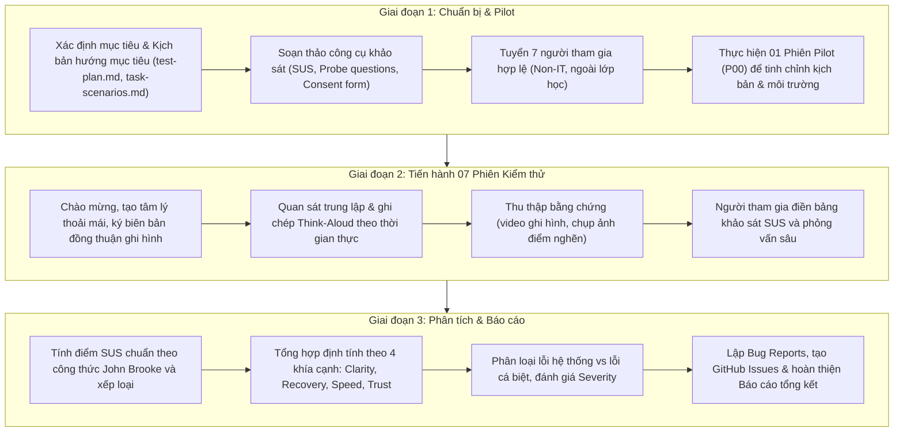

# HW03 Task 2 — Đánh giá Khả năng Sử dụng (Usability Evaluation Workspace)

## 1. Tổng quan & Mục tiêu Đánh giá (Task 2 Objectives)

Workspace này thiết lập cơ sở hạ tầng, tài liệu lập kế hoạch, bộ công cụ chuẩn hóa và quy trình thực hiện cho **Task 2 – Usability Evaluation** thuộc bài tập lớn HW03 (GUI & Usability Testing), áp dụng trên hệ thống **EShop** (Vietnamese E-commerce Demo SUT).

### Mục tiêu cốt lõi:
1. **Thiết kế & Vận hành Đánh giá Usability Có Điều Phối (Moderated Usability Evaluation):** Thực hiện phiên kiểm thử tương tác thực tế với **07 người dùng thật** (ngoài phạm vi lớp học) kết hợp giao thức **Think-Aloud** (suy nghĩ thành tiếng).
2. **Khảo sát Độ Dễ Dùng & Mức Độ Hài Lòng Định Lượng:** Áp dụng thang đo chuẩn quốc tế **System Usability Scale (SUS)** 10 câu hỏi để đo lường điểm số trực quan, đối chiếu với ngưỡng chuẩn ngành (68.0 điểm).
3. **Thu Thập & Phân Tích Dữ Liệu Định Tính:** Đào sâu vào 4 khía cạnh trải nghiệm quan trọng:
   - **Clarity (Độ rõ ràng):** Tính minh bạch của giá, mã giảm giá, nhãn trạng thái và thông điệp hệ thống.
   - **Error Recovery (Phục hồi khi có lỗi):** Khả năng nhận biết và sửa lỗi (nhập coupon sai, điều chỉnh giỏ hàng).
   - **Speed & Efficiency (Tốc độ & Tính tiện lợi):** Cảm nhận về thời gian phản hồi và độ mượt mà của luồng thao tác.
   - **Trust (Độ tin cậy):** Sự an tâm khi thực hiện thanh toán và tính bảo mật của tài khoản.
4. **Phát Hiện & Báo Cáo Lỗi Usability Thực Tế:** Nhận diện các điểm nghẽn trải nghiệm (friction points) và khiếm khuyết nghiệp vụ vi phạm đặc tả SRS, lập Bug Reports chi tiết và đồng bộ lên GitHub Issues.
5. **Tuân thủ Chuẩn Mực AI-First & Anti-AI-Cheat:** Ghi nhật ký tương tác AI minh bạch, phê phán phản biện AI, cam kết tuyệt đối không giả mạo thông tin người tham gia hoặc ngụy tạo bằng chứng.

---

## 2. Luồng Kiểm thử Mua sắm Khép kín Được chọn (Selected Testing Flow)

Để đáp ứng yêu cầu chọn một luồng hoàn chỉnh xuyên suốt từ đầu đến cuối (End-to-End Flow), nhóm chọn luồng mua sắm tích hợp mã giảm giá:

```text
┌──────────────┐     ┌──────────────┐     ┌──────────────────┐
│  1. Đăng nhập │ ──► │  2. Giỏ hàng  │ ──► │ 3. Áp dụng Coupon │
│   (Login)    │     │    (Cart)    │     │  (Apply Coupon)  │
└──────────────┘     └──────────────┘     └──────────────────┘
                                                    │
                                                    ▼
┌──────────────┐     ┌──────────────┐     ┌──────────────────┐
│ 6. Đăng xuất  │ ◄── │ 5. Kiểm tra  │ ◄── │  4. Thanh toán   │
│   (Logout)   │     │   Đơn hàng   │     │    (Checkout)    │
└──────────────┘     └──────────────┘     └──────────────────┘
```

---

## 3. Ma trận Yêu cầu Nghiệp vụ Liên quan (Related Functional Requirements)

Luồng kiểm thử bao hàm 6 yêu cầu chức năng cốt lõi được định nghĩa trong [README.md](../README.md):

| Mã FR | Tên yêu cầu chức năng | Tóm tắt đặc tả nghiệp vụ đúng trong SRS | Trọng tâm kiểm thử Usability |
|:---:|---|---|---|
| **FR-02** | Đăng nhập & Khóa tài khoản | Người dùng nhập Email và Mật khẩu. Đăng nhập sai 3 lần liên tiếp bị tạm khóa 30s. Thành công lưu JWT Token. Trường email dùng `type="email"`. | Độ rõ ràng của thông báo lỗi đăng nhập, tính tự nhiên khi chuyển hướng sau đăng nhập, tính tiện lợi khi đăng xuất. |
| **FR-07** | Giỏ hàng (Shopping Cart) | Hiển thị bảng: Sản phẩm, Đơn giá, Số lượng (+/-), Thành tiền, Thao tác. Nút xóa phải có dialog xác nhận. Nút "Tiếp tục mua sắm". Nhãn tổng tiền bắt buộc là **"Tổng cộng"** (không phải "Tổng tạm tính"). | Trải nghiệm chỉnh sửa số lượng, sự rõ ràng của dialog xác nhận xóa, tính minh bạch của nhãn chi phí. |
| **FR-08** | Thanh toán (Checkout) | Bắt buộc đã đăng nhập. Hiển thị tóm tắt đơn hàng. Tổng tiền tính tự động từ giỏ hàng. Sau thanh toán thành công, giỏ hàng tự động được làm rỗng. | Trải nghiệm xác nhận đơn, cảm giác minh bạch trước khi bấm đặt hàng, độ tin cậy của thông tin giao nhận. |
| **FR-09** | Mã Giảm Giá (Discount Coupon) | Áp dụng mã thỏa 5 điều kiện (C1–C5): Tồn tại & kích hoạt, còn hạn, đủ ngưỡng tối thiểu, đã đăng nhập, chưa hết lượt. Hệ thống tự trừ tiền đúng công thức `percent` hoặc `fixed`. | Nhận diện ô nhập coupon, phản hồi thông báo lỗi khi không đủ điều kiện, hiển thị rõ số tiền được trừ. |
| **FR-10** | Trạng thái Đơn hàng | 5 trạng thái chuyển đổi: `pending` → `confirmed` → `shipping` → `delivered`. Nhánh hủy: `canceled`. Trạng thái `delivered` và `canceled` là kết thúc. | Người dùng hiểu được trạng thái đơn vừa đặt, nhận diện đúng tiến trình xử lý đơn hàng. |
| **FR-11** | Lịch sử Đơn hàng (User) | Người dùng xem đơn hàng của chính mình: Mã đơn, Ngày đặt, Tổng tiền, Trạng thái. Trạng thái phải được dịch sang **tiếng Việt rõ ràng và phân biệt màu sắc**. | Dễ dàng tìm thấy trang lịch sử đơn, trạng thái hiển thị bằng tiếng Việt chuẩn mực, màu sắc trực quan. |

---

## 4. Cấu trúc Thư mục Workspace (Directory Structure)

```text
task-2-usability-evaluation/
├── README.md                                  # Tài liệu điều phối tổng thể workspace Task 2
├── prompts/                                   # Kịch bản hướng dẫn và prompt bằng tiếng Anh
│   ├── 00-prepare-workspace.md                # Prompt thiết lập workspace & nguyên tắc
│   ├── 01-planning-and-instruments.md         # Prompt lập kế hoạch & thiết kế công cụ
│   ├── 02-participant-recruitment-and-pilot.md# Prompt tuyển dụng & chạy thử nghiệm Pilot
│   ├── 03-session-observation-and-notes.md    # Prompt điều phối phiên & thu thập dữ liệu
│   ├── 04-quantitative-qualitative-analysis.md# Prompt tính điểm SUS & tổng hợp định tính
│   └── 05-bug-reporting-and-issues.md         # Prompt báo cáo lỗi & đồng bộ GitHub Issues
├── planning/                                  # Tài liệu kế hoạch & kịch bản kiểm thử
│   ├── test-plan.md                           # Kế hoạch đánh giá Usability toàn diện
│   └── task-scenarios.md                      # Kịch bản nhiệm vụ hướng mục tiêu (Goal-Oriented)
├── instruments/                               # Bộ công cụ khảo sát & biểu mẫu chuẩn hóa
│   ├── sus-questionnaire-template.md          # Thang đo chuẩn System Usability Scale (SUS)
│   ├── ueq-s-questionnaire-template.md        # Thang đo trải nghiệm người dùng rút gọn (UEQ-S)
│   ├── post-test-probe-questions.md           # Bộ câu hỏi phỏng vấn sâu (Clarity, Recovery, Speed, Trust)
│   └── observer-briefing-and-consent.md       # Hướng dẫn điều phối viên & Phiếu đồng thuận cam kết
├── participants/                              # Quản lý người tham gia & ghi chép phiên
│   ├── participant-roster-template.md         # Danh sách 07 người tham gia (ẩn 4 số giữa SĐT/Zalo)
│   ├── session-notes-template.md              # Biểu mẫu ghi chép quan sát phiên (Think-Aloud)
│   └── pilot-session-notes-template.md        # Biểu mẫu kết quả phiên chạy thử nghiệm Pilot
├── analysis/                                  # Tổng hợp dữ liệu & báo cáo phân tích
│   ├── sus-scoring-template.md                # Bảng tính & mô hình chấm điểm chuẩn SUS
│   ├── qualitative-synthesis-template.md      # Tổng hợp định tính theo chủ đề & ma trận mức độ
│   └── usability-summary-report-template.md   # Mẫu báo cáo tổng kết Usability Evaluation
├── bug-reports/                               # Quản lý lỗi Usability phát hiện được
│   ├── README.md                              # Quy ước phân loại Severity/Priority & nhãn GitHub
│   └── BUG-REPORT-TEMPLATE.md                 # Biểu mẫu Bug Report chuẩn hóa theo Task 1
├── ai-audit/                                  # Nhật ký kiểm toán AI & phản biện
│   ├── ai-audit-log.md                        # Bảng theo dõi tương tác AI chi tiết
│   └── ai-critique.md                         # Bản phê phán phản biện AI (200–300 từ)
└── evidence/                                  # Lưu trữ bằng chứng thực nghiệm
    ├── README.md                              # Hướng dẫn lưu trữ video, ảnh chụp và issue
    ├── session-recordings/                    # Thư mục lưu video ghi hình màn hình / audio
    ├── screenshots/                           # Thư mục lưu ảnh chụp màn hình điểm nghẽn & lỗi
    └── github-issues/                         # Thư mục lưu bản sao GitHub Issues markdown
```

---

## 5. Trình tự Thực thi 3 Giai đoạn (Execution Sequence)

Quy trình thực thi Task 2 tuân thủ chặt chẽ đề cương HW03 Section 6:



---

## 6. Danh mục Sản phẩm Bàn giao Bắt buộc (Required Deliverables)

1. **Kế hoạch & Kịch bản kiểm thử:** `planning/test-plan.md` và `planning/task-scenarios.md`.
2. **Bộ công cụ đánh giá đã thực thi:** Phiếu trả lời SUS của 7 người tham gia (`instruments/`), câu hỏi phỏng vấn sâu đã điền và biên bản cam kết đồng thuận.
3. **Danh sách người tham gia được xác thực:** Bảng danh sách 7 người tham gia hợp lệ trong `participants/participant-roster-template.md` (ẩn 4 số giữa SĐT/Zalo, sẵn sàng cho TA kiểm tra).
4. **Biên bản ghi chép 7 phiên quan sát:** 7 bản ghi chép chi tiết (`session-notes-P01.md` đến `session-notes-P07.md`) kèm bản ghi phiên Pilot.
5. **Kết quả tính điểm SUS và tổng hợp định tính:** `analysis/sus-scoring-template.md` và `analysis/qualitative-synthesis-template.md`.
6. **Báo cáo lỗi Usability & GitHub Issues:** Các báo cáo lỗi trong `bug-reports/BUG-YYYYMMDD-###.md` kèm đường dẫn đến các GitHub Issues thật trên repository.
7. **Bằng chứng thực nghiệm:** Video ghi hình phiên kiểm thử trong `evidence/session-recordings/` và ảnh chụp màn hình lỗi trong `evidence/screenshots/`.
8. **Báo cáo Tổng kết Usability Evaluation:** Hoàn thiện báo cáo toàn diện bằng tiếng Việt theo `analysis/usability-summary-report-template.md`.
9. **Nhật ký AI Audit & Bản phản biện AI:** `ai-audit/ai-audit-log.md` và `ai-audit/ai-critique.md` (200–300 từ).

---

## 7. Quy tắc Thực hiện Quan trọng (Integrity & Constraints)

- **Nguyên tắc bảo toàn:** Không làm thay đổi hay ghi đè lên các sản phẩm đã hoàn thành của Task 1 trong `task-1-gui-checklist/`.
- **Chính sách Chống gian lận (Anti-AI-Cheat):** Tuyệt đối không sinh dữ liệu giả về người tham gia, không tạo ảnh chụp màn hình hay video nhân tạo. Mọi dữ liệu phải từ người thật và phiên thật.
- **Quy tắc ngôn ngữ:** Giữ toàn bộ tài liệu hướng dẫn và prompt trong `prompts/` bằng tiếng Anh; toàn bộ tài liệu báo cáo, kịch bản, câu hỏi và biên bản bàn giao bằng tiếng Việt chuẩn mực.
- **Đường dẫn tương đối:** Luôn sử dụng đường dẫn tương đối xuất phát từ thư mục gốc của repository (ví dụ: `task-2-usability-evaluation/planning/test-plan.md`).

