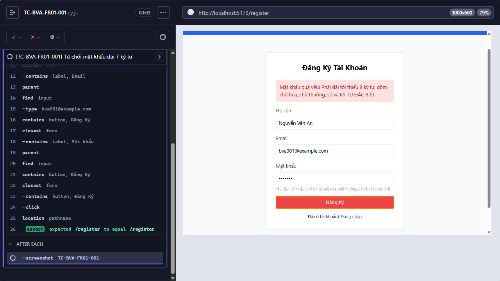

Title: [PASS][Đăng ký tài khoản] Từ chối mật khẩu dài 7 ký tự

## Found by Test Case
TC-BVA-FR01-001

## Requirement liên quan
FR-01

## Severity / Priority
N/A / N/A

## Environment
- Browser: Electron 146.0.7680.216 (headless)
- OS: Windows NT 10.0.26200
- URL: http://127.0.0.1:5173
- Build/commit: 9677c31
- Run window (UTC): 2026-10-14T03:45:46.864Z to 2026-10-14T03:53:28.206Z

## Steps to reproduce
1. Nhập các giá trị như Test data.
2. Gửi form đăng ký.

## Expected result
Hệ thống từ chối đăng ký vì Mật khẩu dưới 8 ký tự.

## Actual result
Cypress ghi nhận trạng thái cuối cùng passed.

## Evidence

