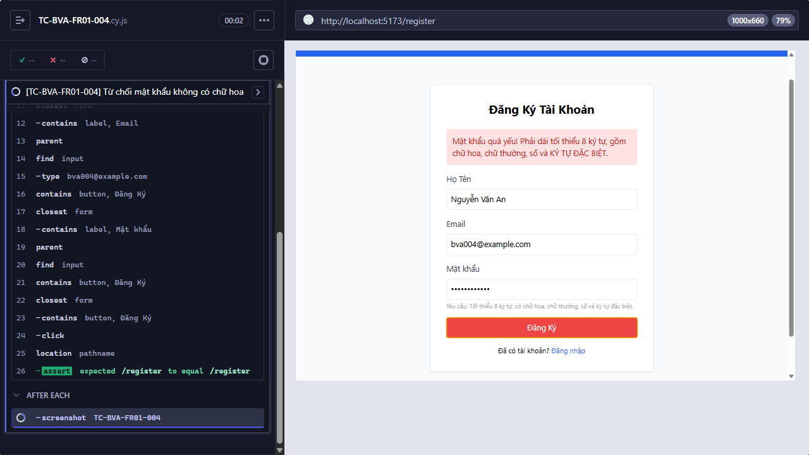

Title: [PASS][Đăng ký tài khoản] Từ chối mật khẩu không có chữ hoa

## Found by Test Case
TC-BVA-FR01-004

## Requirement liên quan
FR-01

## Severity / Priority
N/A / N/A

## Environment
- Browser: Electron 146 (headless)
- OS: Windows 11 Home Single Language (10.0.26200)
- URL: http://localhost:5173
- Build/commit: 755359b (dirty worktree)

## Steps to reproduce
1. Nhập các giá trị như Test data.
2. Gửi form đăng ký.

## Expected result
Hệ thống từ chối đăng ký vì Mật khẩu thiếu chữ hoa.

## Actual result
Cypress thực thi testcase trong 1167 ms; tất cả assertion đạt và hành vi quan sát khớp Expected result.

## Evidence

