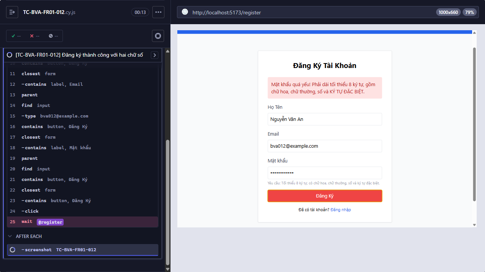

Title: [BUG][Đăng ký tài khoản] Đăng ký thành công với hai chữ số

## Found by Test Case
TC-BVA-FR01-012

## Requirement liên quan
FR-01

## Severity / Priority
TBD / TBD

## Environment
- Browser: Electron 146.0.7680.216 (headless)
- OS: Windows NT 10.0.26200
- URL: http://127.0.0.1:5173
- Build/commit: 9677c31
- Run window (UTC): 2026-10-14T03:45:46.864Z to 2026-10-14T03:53:28.206Z

## Steps to reproduce
1. Nhập các giá trị như Test data.
2. Gửi form đăng ký.

## Expected result
Đăng ký thành công và người dùng được chuyển tới trang Đăng nhập.

## Actual result
CypressError: Timed out retrying after 10000ms: `cy.wait()` timed out waiting `10000ms` for the 1st request to the route: `register`. No request ever occurred.

## Evidence

