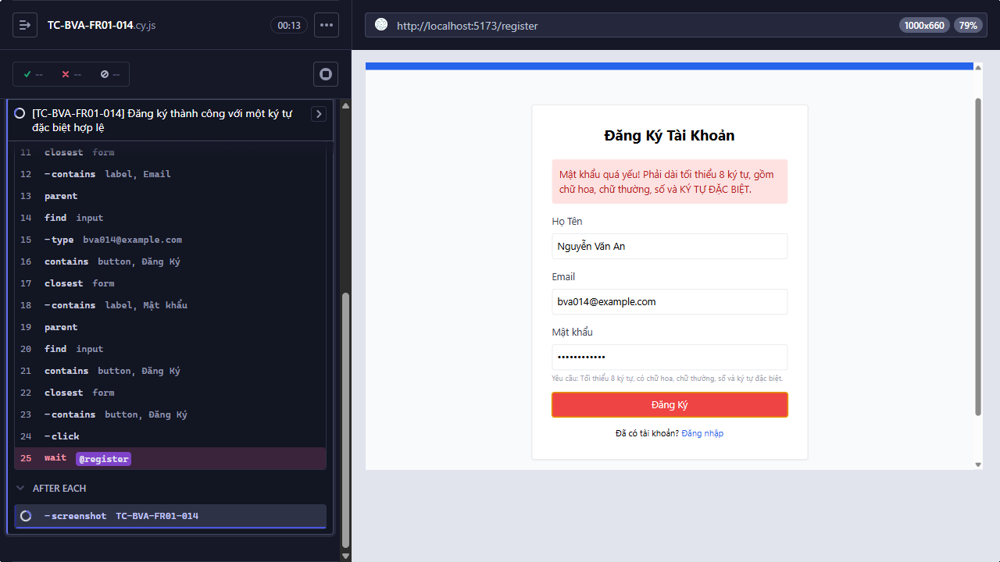

Title: [BUG][Đăng ký tài khoản] Đăng ký thành công với một ký tự đặc biệt hợp lệ

## Found by Test Case
TC-BVA-FR01-014

## Requirement liên quan
FR-01

## Severity / Priority
High / High

## Environment
- Browser: Electron 146 (headless)
- OS: Windows 11 Home Single Language (10.0.26200)
- URL: http://localhost:5173
- Build/commit: 755359b (dirty worktree)

## Steps to reproduce
1. Nhập các giá trị như Test data.
2. Gửi form đăng ký.

## Expected result
Đăng ký thành công và người dùng được chuyển tới trang Đăng nhập.

## Actual result
Sau khi gửi form với mật khẩu đáp ứng FR-01, frontend không phát sinh POST /api/register; Cypress hết thời gian chờ request đăng ký.

## Evidence

