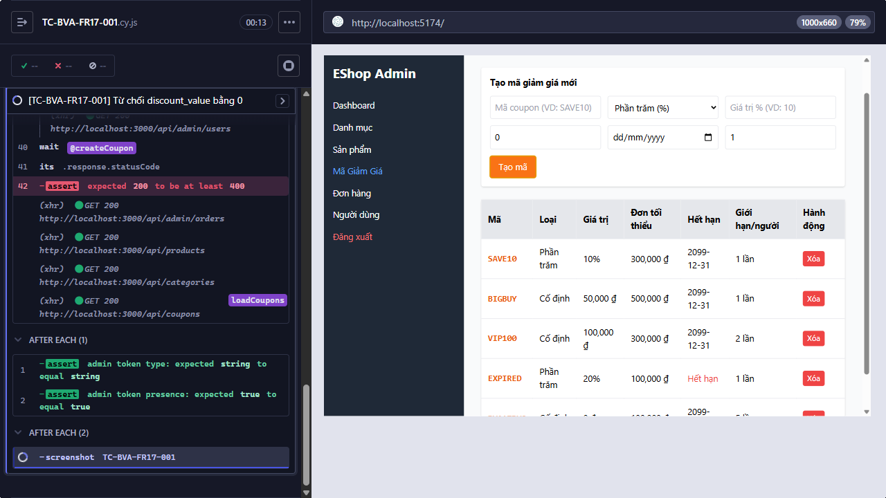

Title: [BUG][Quản lý Mã Giảm Giá] Từ chối discount_value bằng 0

## Found by Test Case
TC-BVA-FR17-001

## Requirement liên quan
FR-17

## Severity / Priority
TBD / TBD

## Environment
- Browser: Electron 146.0.7680.216 (headless)
- OS: Windows NT 10.0.26200
- URL: http://127.0.0.1:5174
- Build/commit: 9677c31
- Run window (UTC): 2026-10-14T03:45:46.864Z to 2026-10-14T03:53:28.206Z

## Steps to reproduce
1. Trong form tạo coupon, nhập code vào `Mã coupon (VD: SAVE10)`, chọn `Số tiền cố định (₫)`, rồi nhập các giá trị Test data vào đúng field theo placeholder UI.
2. Bấm `Tạo mã`.

## Expected result
Hệ thống từ chối tạo mã giảm giá vì `discount_value` không phải giá trị dương.

## Actual result
AssertionError: Timed out retrying after 8000ms: expected 200 to be at least 400

## Evidence

