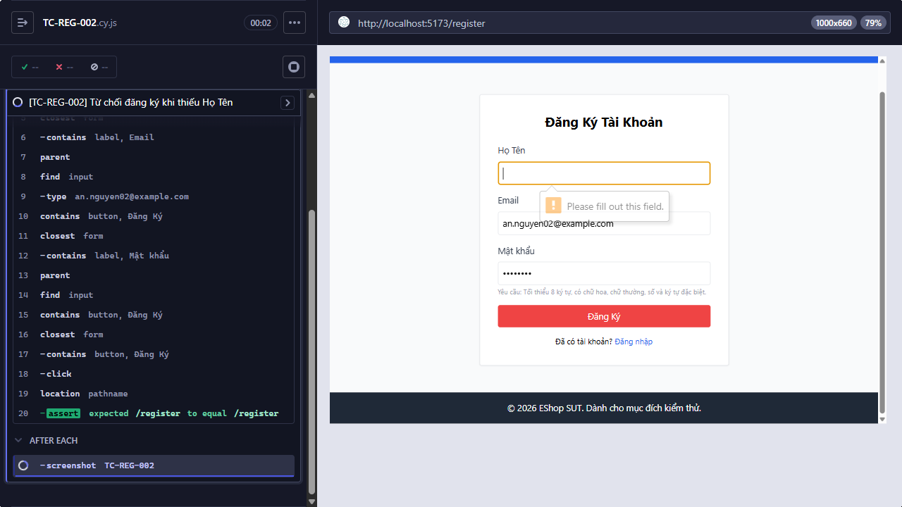

Title: [PASS][Đăng ký] Từ chối đăng ký khi thiếu Họ Tên

## Found by Test Case
TC-REG-002

## Requirement liên quan
FR-01

## Severity / Priority
N/A / N/A

## Environment
- Browser: Electron 146 (headless)
- OS: Windows 11 Home Single Language (10.0.26200)
- URL: http://localhost:5173
- Build/commit: 755359b (dirty worktree)

## Steps to reproduce
1. Để trống Họ Tên.
2. Nhập các trường khác hợp lệ.
3. Gửi form.

## Expected result
Đăng ký không thành công do thiếu Họ Tên. Message cụ thể chưa được mô tả.

## Actual result
Cypress thực thi testcase trong 968 ms; tất cả assertion đạt và hành vi quan sát khớp Expected result.

## Evidence

