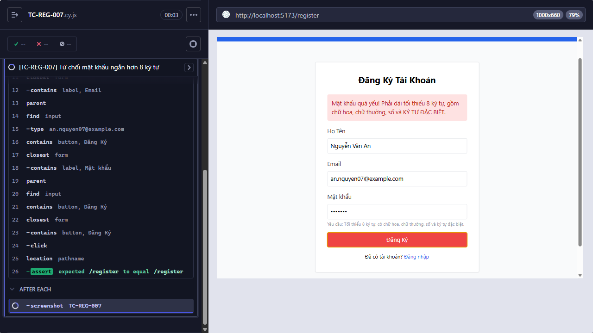

Title: [PASS][Đăng ký] Từ chối mật khẩu ngắn hơn 8 ký tự

## Found by Test Case
TC-REG-007

## Requirement liên quan
FR-01

## Severity / Priority
N/A / N/A

## Environment
- Browser: Electron 146.0.7680.216 (headless)
- OS: Windows NT 10.0.26200
- URL: http://127.0.0.1:5173
- Build/commit: 9677c31
- Run window (UTC): 2026-10-14T03:45:46.864Z to 2026-10-14T03:53:28.206Z

## Steps to reproduce
1. Nhập Mật khẩu 7 ký tự nhưng đủ các thành phần ký tự.
2. Nhập các trường khác hợp lệ.
3. Gửi form.

## Expected result
Đăng ký không thành công do Mật khẩu ngắn hơn 8 ký tự. Message cụ thể chưa được mô tả.

## Actual result
Cypress ghi nhận trạng thái cuối cùng passed.

## Evidence

