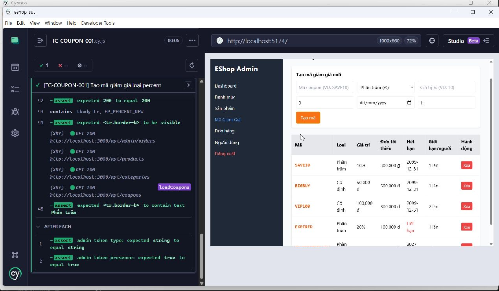

Title: [PASS][Coupon] Tạo mã giảm giá loại percent

## Found by Test Case
TC-COUPON-001

## Requirement liên quan
FR-17

## Severity / Priority
N/A / N/A

## Environment
- Browser: Electron 146 (Cypress Runner, headed)
- OS: Windows NT 10.0.26200
- URL: http://127.0.0.1:5174
- Build/commit: 9677c31
- Run time (UTC): 2026-10-14T04:12:10Z

## Steps to reproduce
1. Đăng nhập trang quản trị và mở chức năng tạo mã giảm giá.
2. Nhập `EP_PERCENT_NEW` vào `Mã coupon (VD: SAVE10)`, chọn `Phần trăm (%)`, rồi nhập các giá trị Test data vào các field tương ứng.
3. Bấm `Tạo mã`.
4. Kiểm tra bảng hiển thị mã mới với Loại là `Phần trăm`.

## Expected result
Mã loại `percent` được tạo. Message cụ thể chưa được mô tả.

## Actual result
Cypress Runner hoàn tất testcase với dấu ✓; bộ đếm hiển thị `1` passed.

## Evidence

