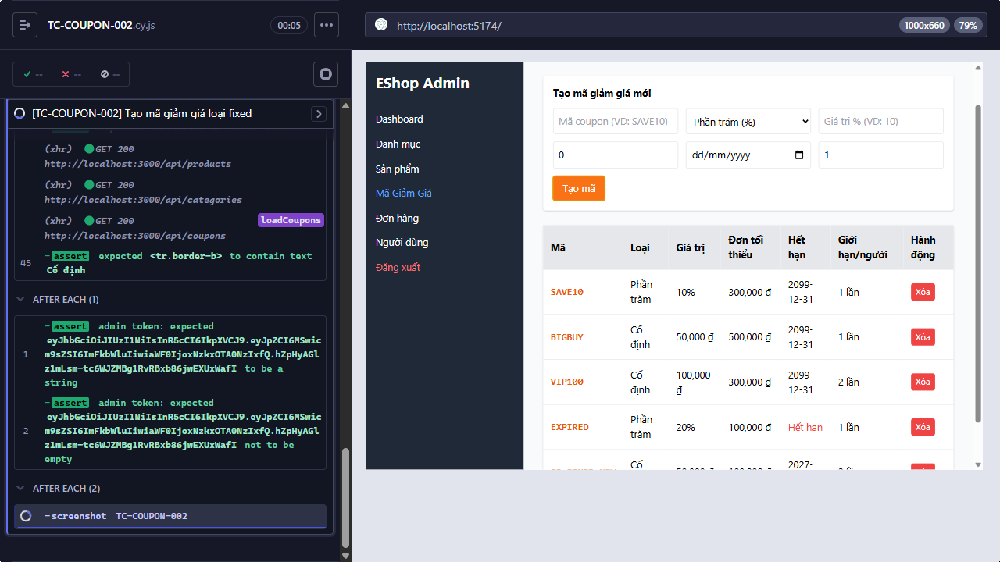

Title: [PASS][Coupon] Tạo mã giảm giá loại fixed

## Found by Test Case
TC-COUPON-002

## Requirement liên quan
FR-17

## Severity / Priority
N/A / N/A

## Environment
- Browser: Electron 146 (headless)
- OS: Windows 11 Home Single Language (10.0.26200)
- URL: http://localhost:5174 (API: http://localhost:3000)
- Build/commit: 755359b (dirty worktree)

## Steps to reproduce
1. Nhập `EP_FIXED_NEW` vào `Mã coupon (VD: SAVE10)`, chọn `Số tiền cố định (₫)`, rồi nhập các giá trị Test data vào các field tương ứng.
2. Bấm `Tạo mã`.
3. Kiểm tra bảng hiển thị mã mới với Loại là `Cố định`.

## Expected result
Mã loại `fixed` được tạo. Message cụ thể chưa được mô tả.

## Actual result
Cypress thực thi testcase trong 2947 ms; tất cả assertion đạt và hành vi quan sát khớp Expected result.

## Evidence

