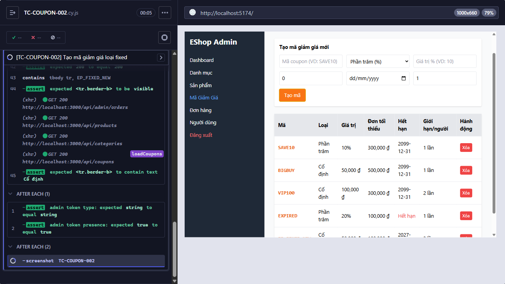

Title: [PASS][Coupon] Tạo mã giảm giá loại fixed

## Found by Test Case
TC-COUPON-002

## Requirement liên quan
FR-17

## Severity / Priority
N/A / N/A

## Environment
- Browser: Electron 146.0.7680.216 (headless)
- OS: Windows NT 10.0.26200
- URL: http://127.0.0.1:5174
- Build/commit: 9677c31
- Run window (UTC): 2026-10-14T03:45:46.864Z to 2026-10-14T03:53:28.206Z

## Steps to reproduce
1. Nhập `EP_FIXED_NEW` vào `Mã coupon (VD: SAVE10)`, chọn `Số tiền cố định (₫)`, rồi nhập các giá trị Test data vào các field tương ứng.
2. Bấm `Tạo mã`.
3. Kiểm tra bảng hiển thị mã mới với Loại là `Cố định`.

## Expected result
Mã loại `fixed` được tạo. Message cụ thể chưa được mô tả.

## Actual result
Cypress ghi nhận trạng thái cuối cùng passed.

## Evidence

