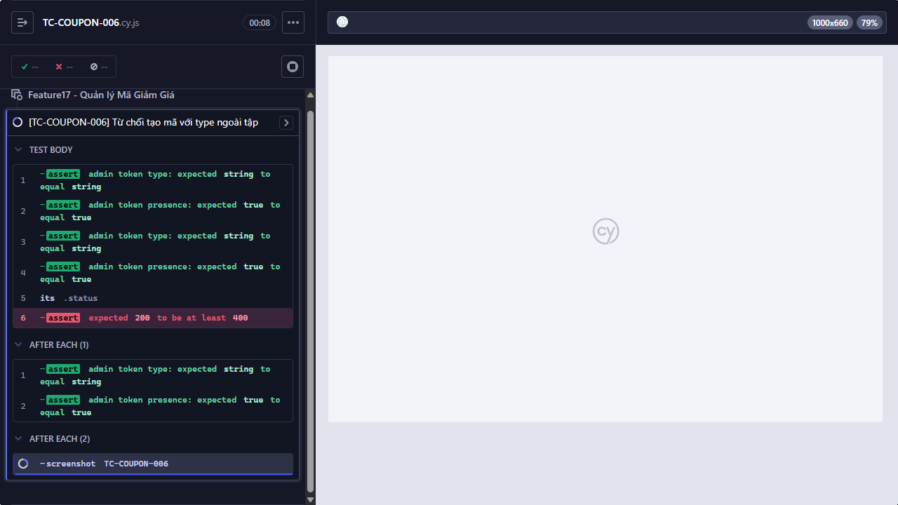

Title: [BUG][Coupon] Từ chối tạo mã với type ngoài tập

## Found by Test Case
TC-COUPON-006

## Requirement liên quan
FR-17

## Severity / Priority
TBD / TBD

## Environment
- Browser: Electron 146.0.7680.216 (headless)
- OS: Windows NT 10.0.26200
- URL: http://127.0.0.1:5174
- Build/commit: 9677c31
- Run window (UTC): 2026-10-14T03:45:46.864Z to 2026-10-14T03:53:28.206Z

## Steps to reproduce
1. Gửi `POST /api/admin/coupons` với token Admin và body đúng Test data; chỉ `type` là `other`.

## Expected result
Từ chối tạo vì `type` không hợp lệ; không khẳng định message. Đây là API-level test vì select UI chỉ có `percent` và `fixed`.

## Actual result
AssertionError: Timed out retrying after 8000ms: expected 200 to be at least 400

## Evidence

