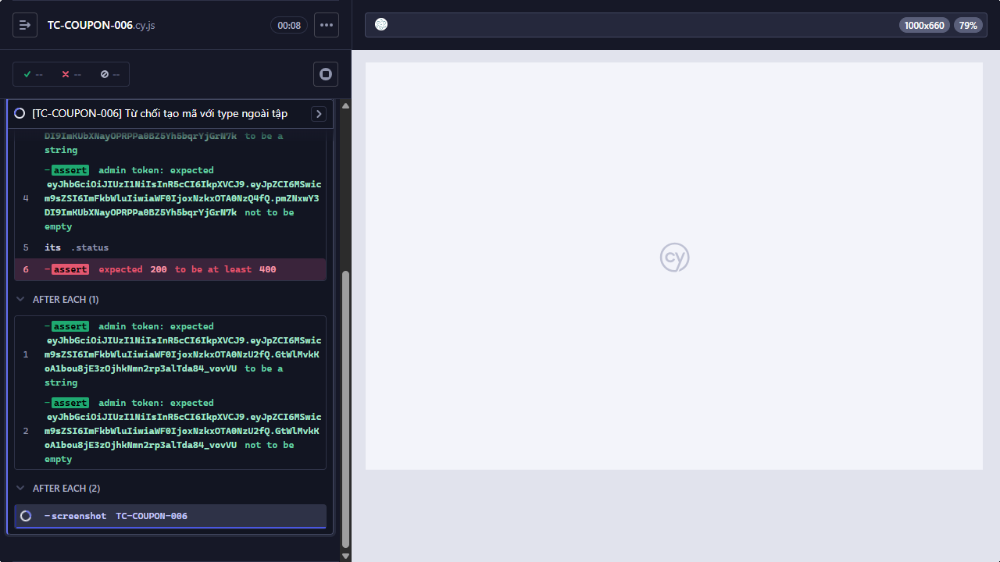

Title: [BUG][Coupon] Từ chối tạo mã với type ngoài tập

## Found by Test Case
TC-COUPON-006

## Requirement liên quan
FR-17

## Severity / Priority
High / High

## Environment
- Browser: Electron 146 (headless)
- OS: Windows 11 Home Single Language (10.0.26200)
- URL: http://localhost:5174 (API: http://localhost:3000)
- Build/commit: 755359b (dirty worktree)

## Steps to reproduce
1. Gửi `POST /api/admin/coupons` với token Admin và body đúng Test data; chỉ `type` là `other`.

## Expected result
Từ chối tạo vì `type` không hợp lệ; không khẳng định message. Đây là API-level test vì select UI chỉ có `percent` và `fixed`.

## Actual result
POST /api/admin/coupons trả HTTP 200 cho type rỗng hoặc type other thay vì từ chối.

## Evidence

