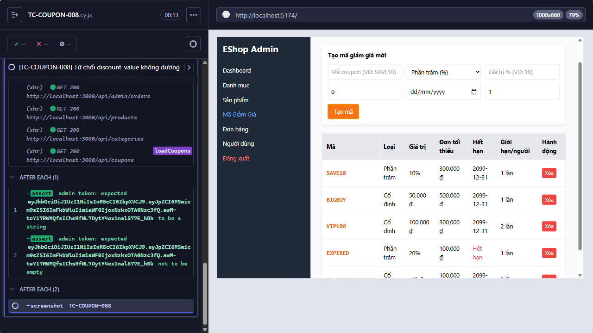

Title: [BUG][Coupon] Từ chối discount_value không dương

## Found by Test Case
TC-COUPON-008

## Requirement liên quan
FR-17

## Severity / Priority
High / High

## Environment
- Browser: Electron 146 (headless)
- OS: Windows 11 Home Single Language (10.0.26200)
- URL: http://localhost:5174 (API: http://localhost:3000)
- Build/commit: 755359b (dirty worktree)

## Steps to reproduce
1. Nhập `-10` vào `Số tiền (VD: 50000)` và nhập đúng các field còn lại theo Test data.
2. Bấm `Tạo mã`.

## Expected result
Từ chối tạo vì `discount_value` không dương.

## Actual result
POST tạo coupon với discount_value = -10 trả HTTP 200.

## Evidence

