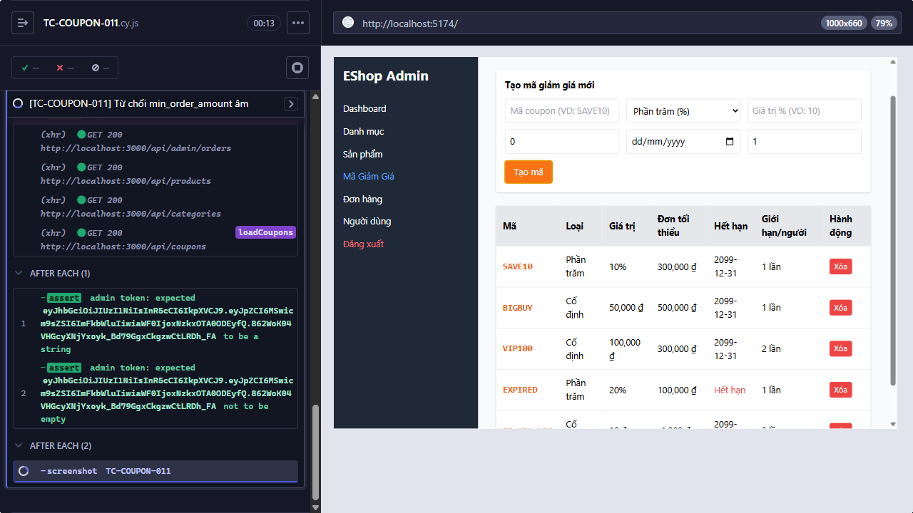

Title: [BUG][Coupon] Từ chối min_order_amount âm

## Found by Test Case
TC-COUPON-011

## Requirement liên quan
FR-17

## Severity / Priority
Medium / High

## Environment
- Browser: Electron 146 (headless)
- OS: Windows 11 Home Single Language (10.0.26200)
- URL: http://localhost:5174 (API: http://localhost:3000)
- Build/commit: 755359b (dirty worktree)

## Steps to reproduce
1. Nhập `-1000` vào `Đơn tối thiểu (₫)` và nhập đúng các field còn lại theo Test data.
2. Bấm `Tạo mã`.

## Expected result
Từ chối tạo vì `min_order_amount < 0`.

## Actual result
POST tạo coupon trả HTTP 200 khi min_order_amount bị bỏ trống hoặc bằng -1000.

## Evidence

