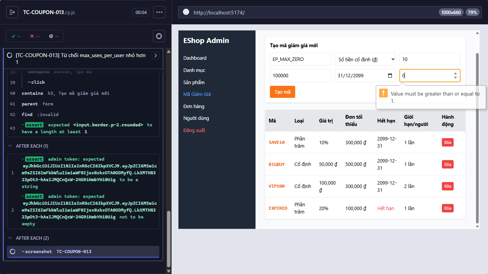

Title: [PASS][Coupon] Từ chối max_uses_per_user nhỏ hơn 1

## Found by Test Case
TC-COUPON-013

## Requirement liên quan
FR-17

## Severity / Priority
N/A / N/A

## Environment
- Browser: Electron 146 (headless)
- OS: Windows 11 Home Single Language (10.0.26200)
- URL: http://localhost:5174 (API: http://localhost:3000)
- Build/commit: 755359b (dirty worktree)

## Steps to reproduce
1. Nhập `0` vào `Số lần dùng tối đa/người` và nhập đúng các field còn lại theo Test data.
2. Bấm `Tạo mã`.

## Expected result
Từ chối tạo vì `max_uses_per_user < 1`.

## Actual result
Cypress thực thi testcase trong 2597 ms; tất cả assertion đạt và hành vi quan sát khớp Expected result.

## Evidence

