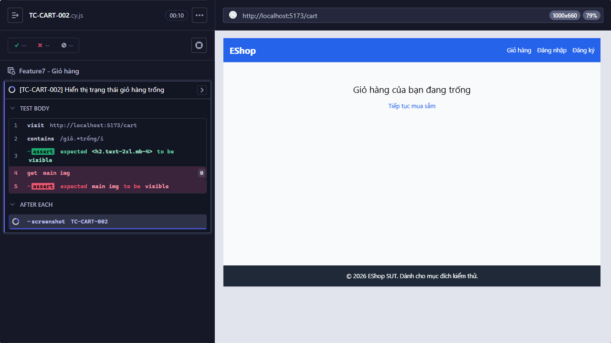

Title: [BUG][Giỏ hàng] Hiển thị trạng thái giỏ hàng trống

## Found by Test Case
TC-CART-002

## Requirement liên quan
FR-07

## Severity / Priority
TBD / TBD

## Environment
- Browser: Electron 146.0.7680.216 (headless)
- OS: Windows NT 10.0.26200
- URL: http://127.0.0.1:5173
- Build/commit: 9677c31
- Run window (UTC): 2026-10-14T03:45:46.864Z to 2026-10-14T03:53:28.206Z

## Steps to reproduce
1. Mở/refresh giỏ trống.
2. Quan sát empty state.

## Expected result
Có cả hình minh họa và thông báo rõ rằng giỏ đang trống; không yêu cầu câu chữ cụ thể.

## Actual result
AssertionError: Timed out retrying after 8000ms: Expected to find element: `main img`, but never found it.

## Evidence

