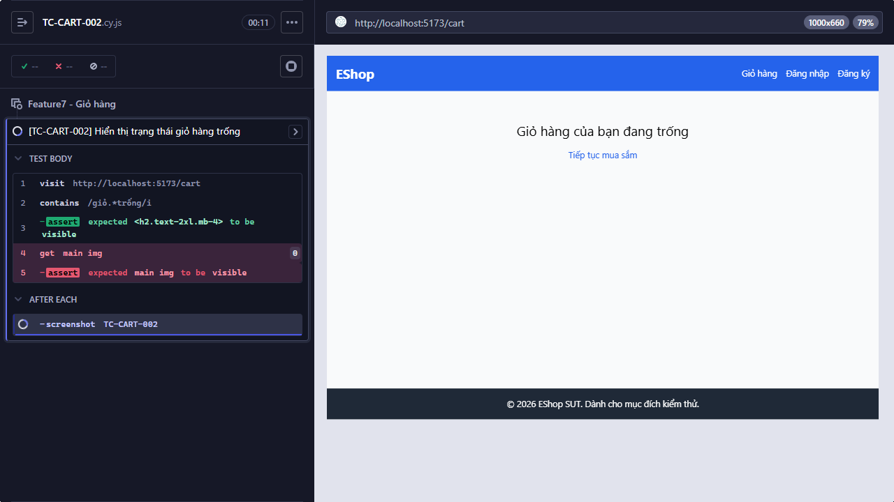

Title: [BUG][Giỏ hàng] Hiển thị trạng thái giỏ hàng trống

## Found by Test Case
TC-CART-002

## Requirement liên quan
FR-07

## Severity / Priority
Low / Medium

## Environment
- Browser: Electron 146 (headless)
- OS: Windows 11 Home Single Language (10.0.26200)
- URL: http://localhost:5173
- Build/commit: 755359b (dirty worktree)

## Steps to reproduce
1. Mở/refresh giỏ trống.
2. Quan sát empty state.

## Expected result
Có cả hình minh họa và thông báo rõ rằng giỏ đang trống; không yêu cầu câu chữ cụ thể.

## Actual result
Trang giỏ hàng trống hiển thị thông báo nhưng Cypress không tìm thấy phần tử ảnh trong main.

## Evidence

