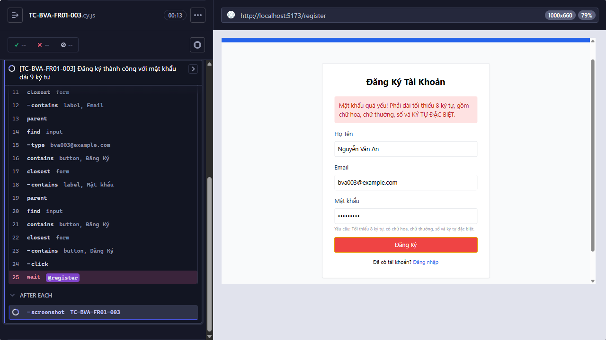
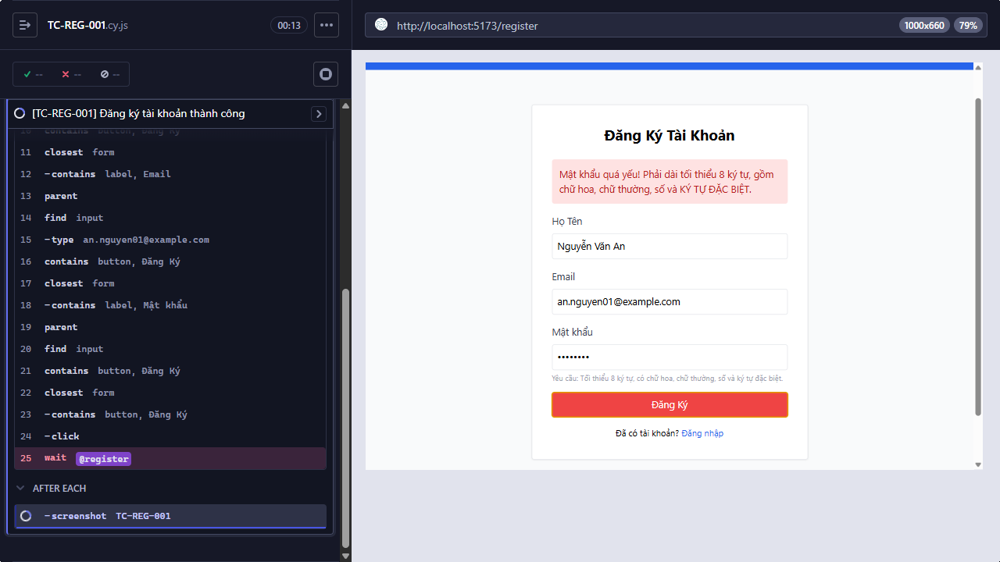

## Mô tả lỗi
Form đăng ký từ chối mật khẩu mạnh hợp lệ

Testcase phát hiện:
- TC-BVA-FR01-002
- TC-BVA-FR01-003
- TC-BVA-FR01-005
- TC-BVA-FR01-006
- TC-BVA-FR01-008
- TC-BVA-FR01-009
- TC-BVA-FR01-011
- TC-BVA-FR01-012
- TC-BVA-FR01-014
- TC-BVA-FR01-015
- TC-REG-001

## Môi trường
- Browser: Electron 146 (headless)
- OS: Windows 11 Home Single Language (10.0.26200)
- URL: http://localhost:5173
- Build/commit: 755359b (dirty worktree)

## Steps to reproduce
1. Mở trang Đăng ký.
2. Nhập Họ Tên, Email chưa tồn tại và một mật khẩu hợp lệ từ testcase liên quan.
3. Bấm Đăng Ký.
4. Quan sát request đăng ký và trang đích.

## Actual result
Sau khi gửi form với mật khẩu đáp ứng FR-01, frontend không phát sinh POST /api/register; Cypress hết thời gian chờ request đăng ký.

## Expected result
Mật khẩu có tối thiểu 8 ký tự, chữ hoa, chữ thường, chữ số và ký tự đặc biệt hợp lệ phải được chấp nhận và đăng ký thành công.

## Evidence

