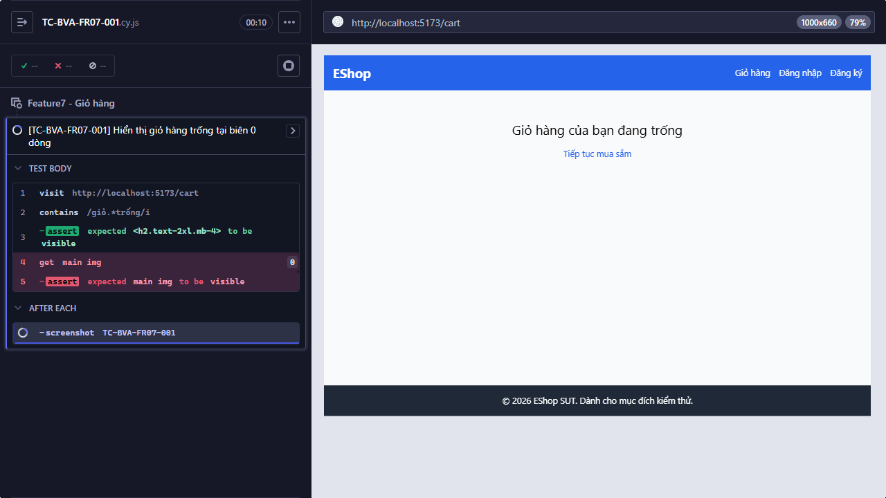

## Mô tả lỗi
Trạng thái giỏ hàng trống thiếu hình minh họa

Testcase phát hiện:
- TC-BVA-FR07-001
- TC-CART-002

## Môi trường
- Browser: Electron 146 (headless)
- OS: Windows 11 Home Single Language (10.0.26200)
- URL: http://localhost:5173
- Build/commit: 755359b (dirty worktree)

## Steps to reproduce
1. Mở trang Giỏ hàng với giỏ không có sản phẩm.
2. Quan sát empty state trong vùng nội dung chính.
3. Kiểm tra thông báo và hình minh họa.

## Actual result
Trang giỏ hàng trống hiển thị thông báo nhưng Cypress không tìm thấy phần tử ảnh trong main.

## Expected result
Trạng thái giỏ hàng trống phải có cả hình minh họa và thông báo rõ ràng.

## Evidence

