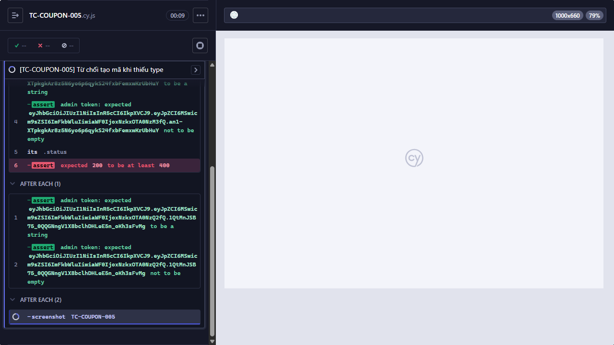

## Mô tả lỗi
API tạo coupon chấp nhận type rỗng hoặc ngoài tập

Testcase phát hiện:
- TC-COUPON-005
- TC-COUPON-006

## Môi trường
- Browser: Electron 146 (headless)
- OS: Windows 11 Home Single Language (10.0.26200)
- URL: http://localhost:5174 (API: http://localhost:3000)
- Build/commit: 755359b (dirty worktree)

## Steps to reproduce
1. Đăng nhập bằng tài khoản admin.
2. Gửi POST /api/admin/coupons với body hợp lệ ngoại trừ type rỗng hoặc other.
3. Quan sát HTTP status của response.

## Actual result
POST /api/admin/coupons trả HTTP 200 cho type rỗng hoặc type other thay vì từ chối.

## Expected result
type là bắt buộc và chỉ được nhận percent hoặc fixed.

## Evidence

