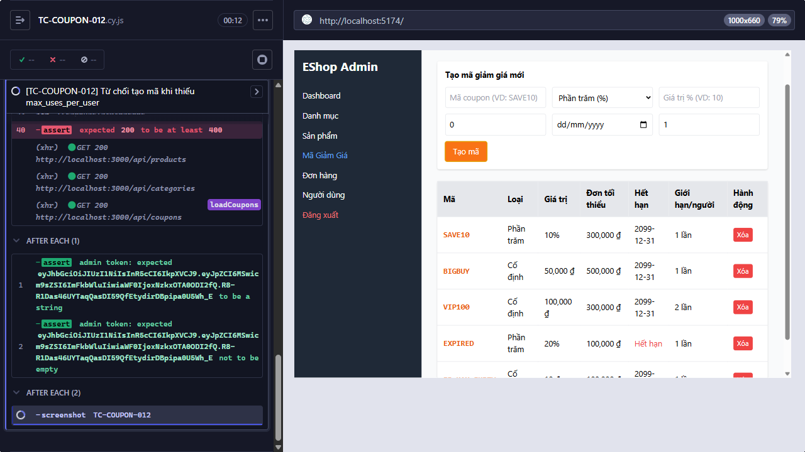

## Mô tả lỗi
Hệ thống chấp nhận thiếu max_uses_per_user

Testcase phát hiện:
- TC-COUPON-012

## Môi trường
- Browser: Electron 146 (headless)
- OS: Windows 11 Home Single Language (10.0.26200)
- URL: http://localhost:5174 (API: http://localhost:3000)
- Build/commit: 755359b (dirty worktree)

## Steps to reproduce
1. Đăng nhập trang quản trị và mở Mã Giảm Giá.
2. Nhập các trường coupon hợp lệ và để trống max_uses_per_user.
3. Bấm Tạo mã và quan sát response.

## Actual result
POST tạo coupon không cung cấp max_uses_per_user trả HTTP 200.

## Expected result
max_uses_per_user là bắt buộc và phải lớn hơn hoặc bằng 1.

## Evidence

