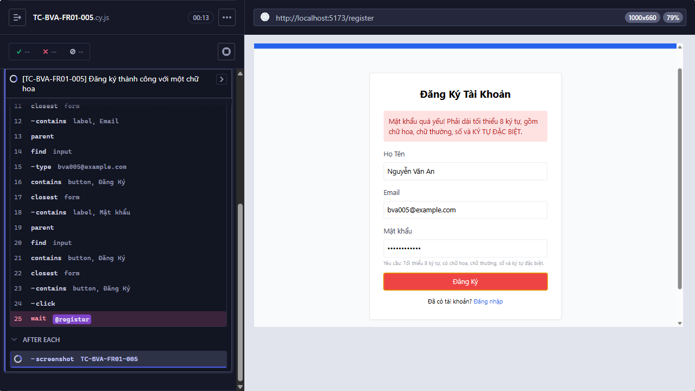
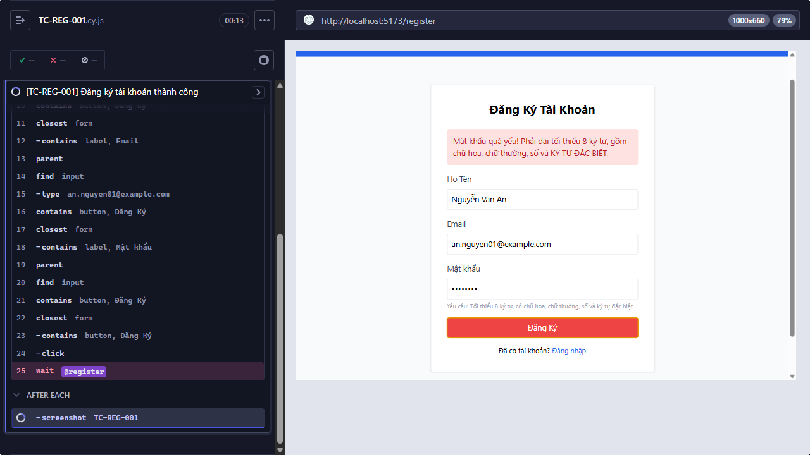

# [BUG][FR-01] Form đăng ký từ chối mật khẩu mạnh hợp lệ

**Trạng thái:** Open  
**Testcase phát hiện:** `TC-BVA-FR01-002`, `TC-BVA-FR01-003`, `TC-BVA-FR01-005`, `TC-BVA-FR01-006`, `TC-BVA-FR01-008`, `TC-BVA-FR01-009`, `TC-BVA-FR01-011`, `TC-BVA-FR01-012`, `TC-BVA-FR01-014`, `TC-BVA-FR01-015`, `TC-REG-001`

## Các bước tái hiện

1. Mở trang Đăng ký tại `http://localhost:5173`.
2. Nhập Họ Tên và một email chưa tồn tại.
3. Nhập mật khẩu hợp lệ theo FR-01, ví dụ `Abcdef1@`.
4. Bấm **Đăng Ký** và quan sát request gửi tới API.

## Kết quả thực tế

- Frontend hiển thị thông báo mật khẩu yếu.
- Không phát sinh `POST /api/register`; Cypress hết thời gian chờ request đăng ký.
- Tất cả mật khẩu hợp lệ chứa ký tự thuộc tập `@`, `$`, `!`, `%`, `*`, `?`, `&` đều bị chặn ở frontend.

## Kết quả mong đợi

Mật khẩu dài tối thiểu 8 ký tự, có chữ hoa, chữ thường, chữ số và ít nhất một ký tự đặc biệt thuộc tập `@`, `$`, `!`, `%`, `*`, `?`, `&` phải được chấp nhận. Hệ thống gửi request đăng ký và chuyển người dùng tới trang Đăng nhập khi đăng ký thành công.

## Bằng chứng

**Kết luận kiểm tra source:** Có lỗi trong code frontend và đây là nguyên nhân trực tiếp làm request đăng ký không được gửi.

Trong [`frontend-web/src/pages/Register.jsx`](../../../frontend-web/src/pages/Register.jsx#L15-L23), regex dùng `(?=.*\s)` nên bắt buộc mật khẩu phải có khoảng trắng; đồng thời `[A-Za-z\d\s]` lại loại toàn bộ ký tự đặc biệt mà FR-01 yêu cầu. Nhánh `return` dừng xử lý trước lệnh gọi API.

```jsx
const flawedStrongPasswordRegex = /^(?=.*[a-z])(?=.*[A-Z])(?=.*\d)(?=.*\s)[A-Za-z\d\s]{8,}$/;

if (!flawedStrongPasswordRegex.test(password)) {
  setError('Mật khẩu quá yếu! Phải dài tối thiểu 8 ký tự, gồm chữ hoa, chữ thường, số và KÝ TỰ ĐẶC BIỆT.');
  return;
}

try {
  await axios.post('http://localhost:3000/api/register', { name, email, password });
```

Ảnh từ lần chạy Cypress:

- 
- 
- 
- 
- 
- 
- 
- 
- 
- 
- 

## Đề xuất sửa

- Sửa regex frontend để kiểm tra đúng tập ký tự đặc biệt của FR-01, chẳng hạn dùng lookahead `(?=.*[@$!%*?&])` và tập ký tự cho phép tương ứng thay cho `\s`.
- Thực hiện cùng quy tắc validation tại backend trước khi ghi user vào database; frontend validation chỉ phục vụ trải nghiệm và có thể bị bỏ qua.
- Trả HTTP `400` kèm thông báo validation rõ ràng khi mật khẩu không hợp lệ.
- Bổ sung unit test cho từng điều kiện mật khẩu và regression test cho toàn bộ 11 testcase trên.
