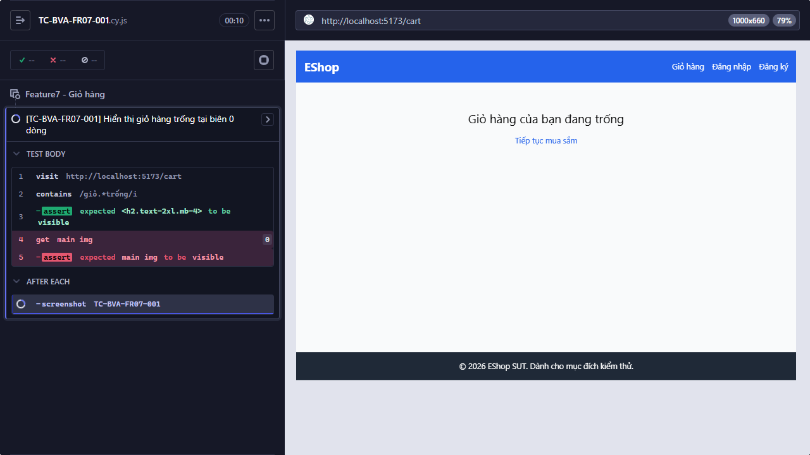
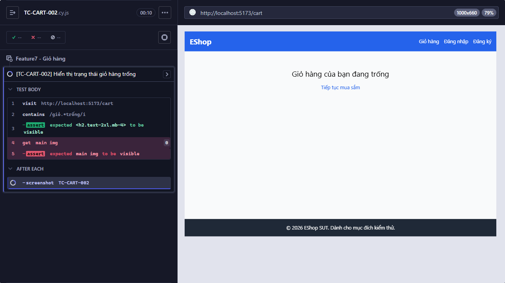

# [BUG][FR-07] Trạng thái giỏ hàng trống thiếu hình minh họa
**Trạng thái:** Open  
**Testcase phát hiện:** `TC-BVA-FR07-001`, `TC-CART-002`

## Các bước tái hiện

1. Đảm bảo giỏ hàng không có sản phẩm.
2. Mở trang Giỏ hàng tại `http://localhost:5173/cart`.
3. Quan sát empty state trong vùng nội dung chính.

## Kết quả thực tế

Trang hiển thị dòng “Giỏ hàng của bạn đang trống” và liên kết “Tiếp tục mua sắm”, nhưng không có hình minh họa. Cypress không tìm thấy phần tử `img` trong `main`.

## Kết quả mong đợi

Giỏ hàng trống phải hiển thị đồng thời hình minh họa và thông báo rõ ràng theo FR-07.

## Bằng chứng

**Kết luận kiểm tra source:** Có lỗi thiếu thành phần trong code frontend và đây là nguyên nhân trực tiếp của failure.

Nhánh empty state trong [`frontend-web/src/pages/Cart.jsx`](../../../frontend-web/src/pages/Cart.jsx#L20-L26) chỉ render tiêu đề và liên kết, hoàn toàn không có phần tử `` hoặc component hình minh họa.

```jsx
if (cart.length === 0) {
  return (
    <div className="text-center mt-10">
      <h2 className="text-2xl mb-4">Giỏ hàng của bạn đang trống</h2>
      <Link to="/" className="text-blue-600 hover:underline">Tiếp tục mua sắm</Link>
    </div>
  );
}
```

Ảnh từ lần chạy Cypress:

- 
- 

## Đề xuất sửa

- Bổ sung một hình minh họa empty-cart vào nhánh `cart.length === 0`, đặt trong vùng nội dung chính và có `alt` mô tả phù hợp.
- Dùng asset cục bộ ổn định hoặc component icon của dự án, tránh phụ thuộc URL ảnh ngoài khi render empty state.
- Giữ nguyên thông báo và liên kết tiếp tục mua sắm; bổ sung kiểm thử accessibility cho `alt` và kiểm thử UI cho hình minh họa.
