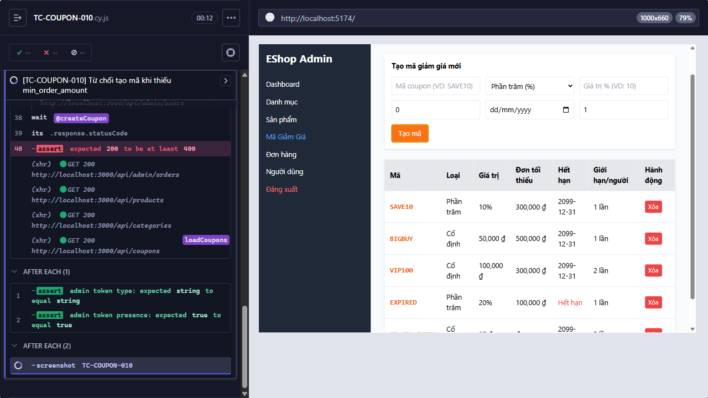
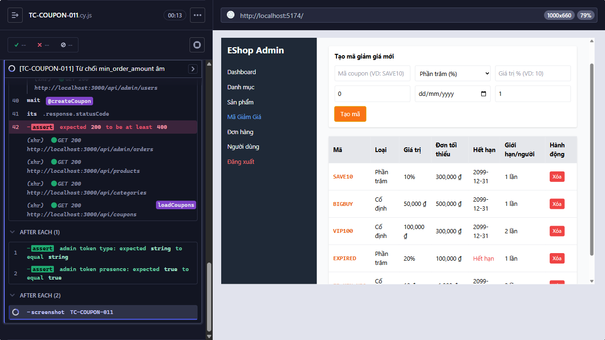

# [BUG][FR-17] Hệ thống chấp nhận min_order_amount thiếu hoặc âm

**Trạng thái:** Open  
**Testcase phát hiện:** `TC-COUPON-010`, `TC-COUPON-011`

## Các bước tái hiện

1. Đăng nhập trang quản trị và mở chức năng **Mã Giảm Giá**.
2. Nhập các trường coupon hợp lệ.
3. Để trống `Đơn tối thiểu (₫)`, sau đó thử lại với giá trị `-1000`.
4. Bấm **Tạo mã** và quan sát response ở mỗi lần thử.

## Kết quả thực tế

API trả HTTP `200` khi `min_order_amount` để trống hoặc bằng `-1000`.

## Kết quả mong đợi

`min_order_amount` là trường bắt buộc và phải là số lớn hơn hoặc bằng `0`; dữ liệu thiếu hoặc âm phải bị từ chối.

## Bằng chứng

**Kết luận kiểm tra source:** Có lỗi validation ở cả frontend, backend và schema; backend thiếu kiểm tra là nguyên nhân trực tiếp khiến request sai vẫn thành công.

Input tại [`frontend-admin/src/App.jsx`](../../../frontend-admin/src/App.jsx#L676-L687) không có `required` và không có `min="0"`.

```jsx
<input
  placeholder="Đơn tối thiểu (₫)"
  type="number"
  className="border p-2 rounded"
  value={couponForm.min_order_amount}
  onChange={(e) =>
    setCouponForm({
      ...couponForm,
      min_order_amount: e.target.value,
    })
  }
/>
```

Endpoint tại [`backend/server.js`](../../../backend/server.js#L457-L478) chuyển nguyên giá trị nhận được vào câu lệnh `INSERT`, không kiểm tra sự hiện diện, kiểu số hoặc điều kiện `>= 0`.

```js
const {
  code,
  type,
  discount_value,
  min_order_amount,
  expired_at,
  max_uses_per_user,
} = req.body;

db.run(
  "INSERT INTO coupons (code, type, discount_value, min_order_amount, expired_at, max_uses_per_user) VALUES (?, ?, ?, ?, ?, ?)",
  [code, type, discount_value, min_order_amount, expired_at, max_uses_per_user || 1],
```

Schema tại [`backend/database.js`](../../../backend/database.js#L28-L38) có giá trị mặc định nhưng không có `NOT NULL` hoặc `CHECK (min_order_amount >= 0)`. Giá trị mặc định cũng không bảo vệ trường hợp ứng dụng chèn rõ chuỗi rỗng hoặc số âm.

```js
min_order_amount INTEGER DEFAULT 0,
```

Ảnh từ lần chạy Cypress:

- 
- 

## Đề xuất sửa

- Backend phải kiểm tra trường này thực sự được cung cấp, chuyển sang số, xác nhận là số hữu hạn và `>= 0`; trả HTTP `400` nếu không hợp lệ.
- Thêm `required` và `min="0"` cho input frontend nhằm ngăn lỗi nhập liệu thông thường.
- Bổ sung `NOT NULL` và `CHECK (min_order_amount >= 0)` trong schema; thực hiện migration an toàn cho dữ liệu hiện có.
- Thêm test API độc lập cho giá trị thiếu, chuỗi rỗng, `null`, không phải số, `-1` và `0`.
