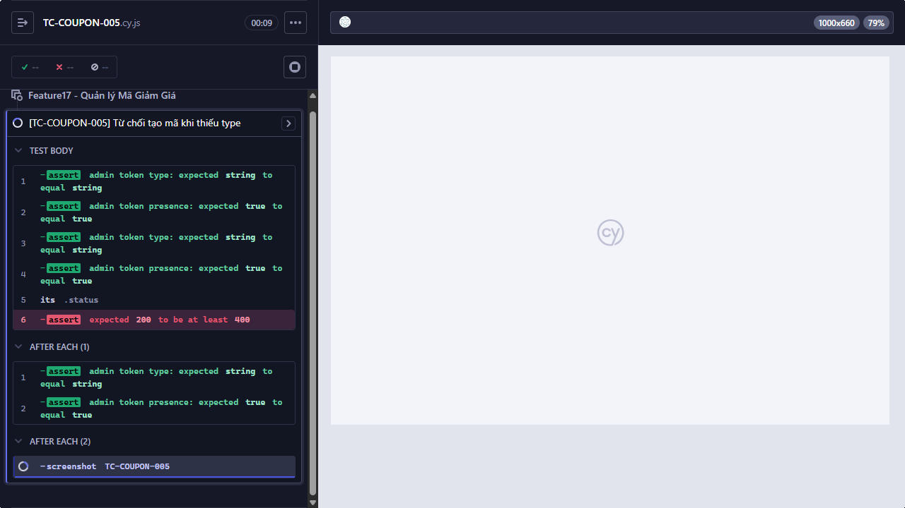

# [BUG][FR-17] API tạo coupon chấp nhận type rỗng hoặc ngoài tập

**Trạng thái:** Open  
**Testcase phát hiện:** `TC-COUPON-005`, `TC-COUPON-006`

## Các bước tái hiện

1. Đăng nhập bằng tài khoản admin hợp lệ.
2. Gửi `POST /api/admin/coupons` với dữ liệu coupon hợp lệ nhưng đặt `type` lần lượt là chuỗi rỗng và `other`.
3. Quan sát HTTP status và dữ liệu được tạo.

## Kết quả thực tế

API trả HTTP `200` và tạo coupon cho cả `type = ""` lẫn `type = "other"`.

## Kết quả mong đợi

API phải từ chối bằng HTTP `400` khi thiếu `type` hoặc khi giá trị không thuộc tập `percent`, `fixed`.

## Bằng chứng

**Kết luận kiểm tra source:** Có lỗi validation trong backend và đây là nguyên nhân trực tiếp khiến dữ liệu không hợp lệ được chấp nhận.

Endpoint trong [`backend/server.js`](../../../backend/server.js#L457-L480) lấy `type` từ body rồi chèn thẳng vào database, không kiểm tra trường bắt buộc hoặc whitelist giá trị.

```js
app.post("/api/admin/coupons", authenticateToken, (req, res) => {
  const {
    code,
    type,
    discount_value,
    min_order_amount,
    expired_at,
    max_uses_per_user,
  } = req.body;
  db.run(
    "INSERT INTO coupons (code, type, discount_value, min_order_amount, expired_at, max_uses_per_user) VALUES (?, ?, ?, ?, ?, ?)",
    [
      code,
      type,
      discount_value,
      min_order_amount,
      expired_at,
      max_uses_per_user || 1,
    ],
```

Schema tại [`backend/database.js`](../../../backend/database.js#L28-L38) cũng chỉ khai báo `type TEXT DEFAULT 'percent'`, không có ràng buộc `NOT NULL` hoặc `CHECK`.

```js
db.run(`CREATE TABLE coupons (
    id INTEGER PRIMARY KEY AUTOINCREMENT,
    code TEXT UNIQUE,
    type TEXT DEFAULT 'percent',
    discount_value INTEGER,
    min_order_amount INTEGER DEFAULT 0,
    expired_at DATETIME,
    is_active INTEGER DEFAULT 1,
    max_uses_per_user INTEGER DEFAULT 1
)`);
```

Ảnh từ lần chạy Cypress:

- 
- 

## Đề xuất sửa

- Tại endpoint tạo coupon, kiểm tra `type` là chuỗi bắt buộc và chỉ chấp nhận `percent` hoặc `fixed`; trả HTTP `400` trước khi gọi `db.run` nếu không hợp lệ.
- Bổ sung `NOT NULL` và `CHECK (type IN ('percent', 'fixed'))` ở tầng database để bảo vệ dữ liệu ngay cả khi validation ứng dụng bị bỏ qua.
- Dùng chung schema/validator cho API và các luồng tạo coupon khác để tránh quy tắc bị lệch nhau.
