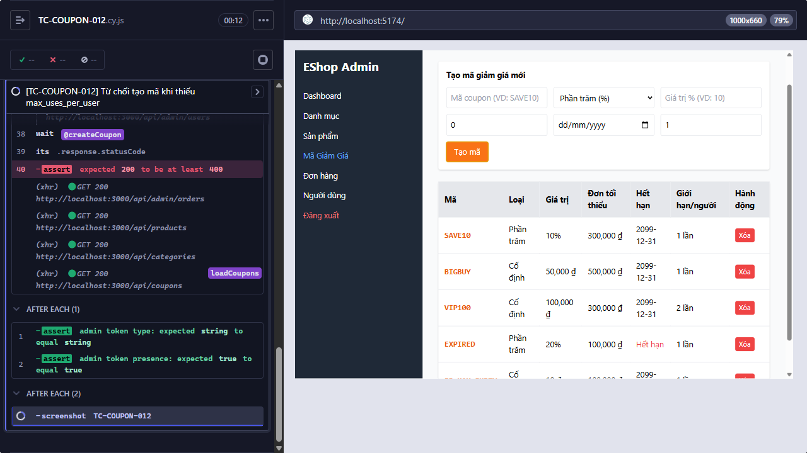

# [BUG][FR-17] Hệ thống chấp nhận thiếu max_uses_per_user

**Trạng thái:** Open  
**Testcase phát hiện:** `TC-COUPON-012`

## Các bước tái hiện

1. Đăng nhập trang quản trị và mở chức năng **Mã Giảm Giá**.
2. Nhập các trường coupon hợp lệ nhưng để trống `Số lần dùng tối đa/người`.
3. Bấm **Tạo mã** và quan sát response.

## Kết quả thực tế

`POST /api/admin/coupons` trả HTTP `200`; backend tự thay giá trị bị thiếu bằng `1` và tạo coupon.

## Kết quả mong đợi

`max_uses_per_user` là trường bắt buộc và phải là số nguyên lớn hơn hoặc bằng `1`; request thiếu trường phải bị từ chối.

## Bằng chứng

**Kết luận kiểm tra source:** Có lỗi trong code frontend và backend. Biểu thức fallback ở backend là nguyên nhân trực tiếp biến dữ liệu thiếu thành hợp lệ ngoài ý muốn.

Input tại [`frontend-admin/src/App.jsx`](../../../frontend-admin/src/App.jsx#L698-L710) có `min="1"` nhưng không có `required`, nên người dùng vẫn có thể xóa giá trị và gửi form.

```jsx
<input
  placeholder="Số lần dùng tối đa/người"
  type="number"
  className="border p-2 rounded"
  value={couponForm.max_uses_per_user}
  onChange={(e) =>
    setCouponForm({
      ...couponForm,
      max_uses_per_user: e.target.value,
    })
  }
  min="1"
/>
```

Trong [`backend/server.js`](../../../backend/server.js#L466-L475), `max_uses_per_user || 1` thay mọi giá trị falsy như `undefined`, `null`, chuỗi rỗng và số `0` bằng `1`; endpoint không kiểm tra trường bắt buộc trước khi insert.

```js
db.run(
  "INSERT INTO coupons (code, type, discount_value, min_order_amount, expired_at, max_uses_per_user) VALUES (?, ?, ?, ?, ?, ?)",
  [
    code,
    type,
    discount_value,
    min_order_amount,
    expired_at,
    max_uses_per_user || 1,
  ],
```

Ảnh từ lần chạy Cypress:

- 

## Đề xuất sửa

- Không dùng `max_uses_per_user || 1` cho trường bắt buộc. Kiểm tra trường có mặt, là số nguyên và `>= 1`; nếu sai trả HTTP `400`.
- Thêm `required` và `step="1"` cho input frontend, giữ `min="1"`.
- Bổ sung `NOT NULL` và `CHECK (max_uses_per_user >= 1)` trong database; chỉ giữ default nếu nghiệp vụ thực sự cho phép client bỏ trường.
- Bổ sung test cho thiếu trường, chuỗi rỗng, `null`, `0`, số âm và số thập phân.
