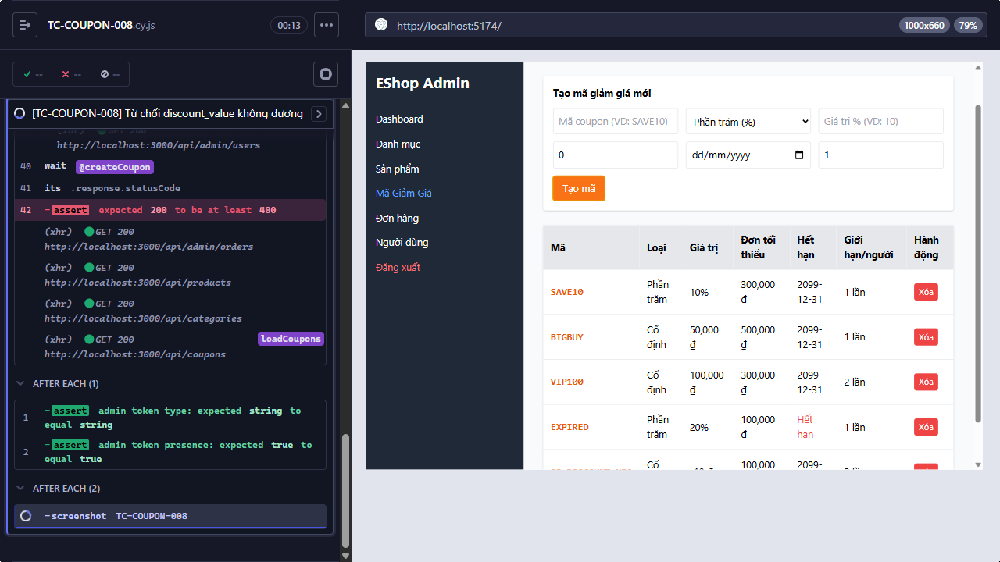

# [BUG][FR-17] Hệ thống chấp nhận discount_value âm

**Trạng thái:** Open  
**Testcase phát hiện:** `TC-COUPON-008`

## Các bước tái hiện

1. Đăng nhập trang quản trị và mở chức năng **Mã Giảm Giá**.
2. Nhập coupon hợp lệ, riêng `discount_value = -10`.
3. Bấm **Tạo mã** và quan sát response.

## Kết quả thực tế

`POST /api/admin/coupons` trả HTTP `200` và coupon có `discount_value = -10` được tạo.

## Kết quả mong đợi

Hệ thống phải từ chối tạo coupon vì `discount_value` bắt buộc là số dương.

## Bằng chứng

**Kết luận kiểm tra source:** Có lỗi validation ở cả frontend và backend; backend thiếu kiểm tra là nguyên nhân quyết định khiến dữ liệu âm được lưu.

Input trong [`frontend-admin/src/App.jsx`](../../../frontend-admin/src/App.jsx#L659-L675) có `required` nhưng không có giới hạn `min`, nên trình duyệt cho phép nhập số âm.

```jsx
<input
  placeholder={
    couponForm.type === "percent"
      ? "Giá trị % (VD: 10)"
      : "Số tiền (VD: 50000)"
  }
  type="number"
  className="border p-2 rounded"
  value={couponForm.discount_value}
  onChange={(e) =>
    setCouponForm({
      ...couponForm,
      discount_value: e.target.value,
    })
  }
  required
/>
```

Endpoint trong [`backend/server.js`](../../../backend/server.js#L457-L478) chèn `discount_value` trực tiếp mà không kiểm tra kiểu số hoặc điều kiện lớn hơn `0`.

```js
const {
  code,
  type,
  discount_value,
  min_order_amount,
  expired_at,
  max_uses_per_user,
} = req.body;

db.run(
  "INSERT INTO coupons (code, type, discount_value, min_order_amount, expired_at, max_uses_per_user) VALUES (?, ?, ?, ?, ?, ?)",
  [code, type, discount_value, min_order_amount, expired_at, max_uses_per_user || 1],
```

Ảnh từ lần chạy Cypress:

- 

## Đề xuất sửa

- Backend phải chuyển `discount_value` sang số, kiểm tra hữu hạn và `> 0`; trả HTTP `400` nếu không đạt.
- Thêm `min` phù hợp cho input frontend để phản hồi sớm, nhưng không dùng validation frontend thay cho backend.
- Cân nhắc ràng buộc `NOT NULL` và `CHECK (discount_value > 0)` trong schema database.
- Nếu `type = percent`, bổ sung giới hạn nghiệp vụ tối đa nếu yêu cầu hệ thống có quy định.
