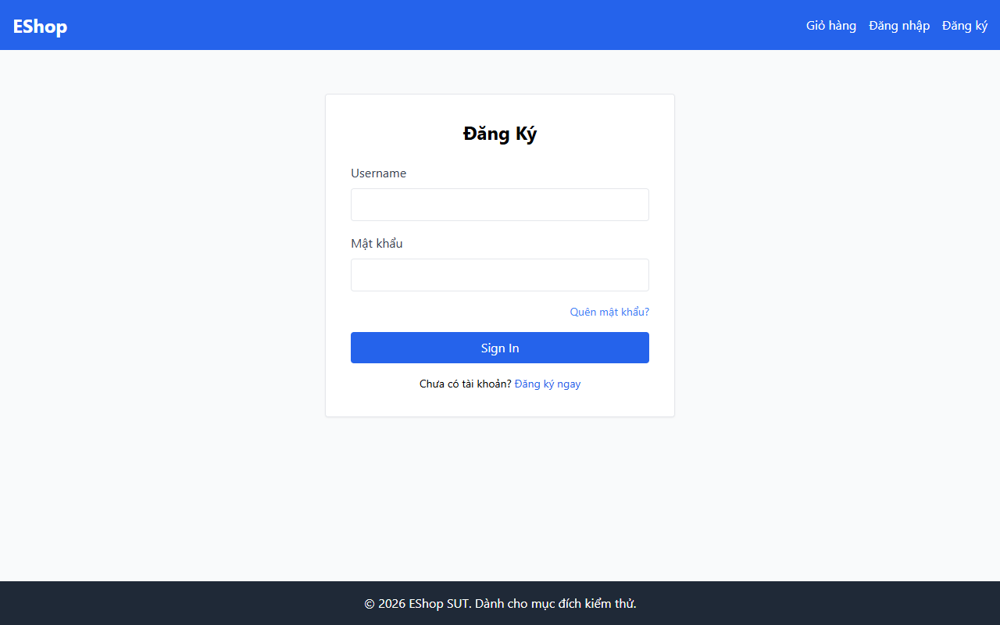

# TC-BVA-ASSOC-001: Biên Khớp Liên kết OTP - Email (Cùng Tài khoản)

## Requirement ID

FR-03 (Bước 2)

## Module / Test Type / Technique

PASSWORD-RESET-WEB / Functional / BVA

## Preconditions

- Tài khoản A: `test@eshop.com` (Đã tạo OTP-A).

## Test Data

| Field | Value |
|---|---|
| Tài khoản Mục tiêu | `test@eshop.com` |
| `otp` | OTP-A |
| `new_password` | `NewPass123!` |
| `confirm_password` | `NewPass123!` |

## Test Steps

1. Gửi yêu cầu đặt lại mật khẩu cho `test@eshop.com` bằng OTP-A.

## Expected Result

- Đặt lại thành công vì OTP-A thuộc về tài khoản `test@eshop.com`.

## Actual Result

Đổi mật khẩu thành công khi mã OTP trùng khớp với email yêu cầu: alert "Đổi mật khẩu thành công!".

**Execution report observation:** Đổi mật khẩu thành công khi OTP khớp với email yêu cầu.

## Evidence

## Test Design Rationale

Điều kiện biên hợp lệ khi định danh người yêu cầu và đối tượng đặt lại trùng khớp (độ lệch định danh bằng 0).

## Status / Related Bugs

PASS / Không có — see [execution report](../../../reports/test-results/FR-03/bva_testing_report.md).
