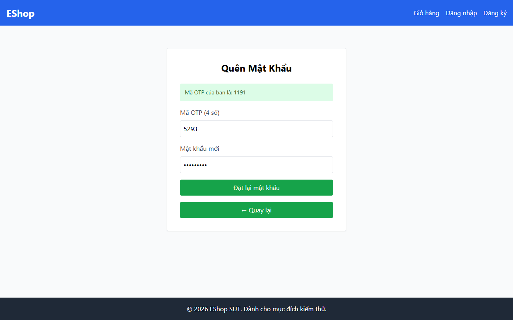

# TC-BVA-ASSOC-002: Biên Lệch Liên kết OTP - Email (Khác Tài khoản)

## Requirement ID

FR-03 (Bước 2)

## Module / Test Type / Technique

PASSWORD-RESET-WEB / Functional / BVA

## Preconditions

- Tài khoản A: `test@eshop.com` (Đã tạo OTP-A).
- Tài khoản B: `admin@eshop.com`.

## Test Data

| Field | Value |
|---|---|
| Tài khoản Mục tiêu | `admin@eshop.com` |
| `otp` | OTP-A (được tạo cho `test@eshop.com`) |
| `new_password` | `AdminPass123!` |
| `confirm_password` | `AdminPass123!` |

## Test Steps

1. Gửi yêu cầu đặt lại mật khẩu cho `admin@eshop.com` bằng OTP-A.

## Expected Result

- Yêu cầu bị từ chối vì OTP-A không hợp lệ cho `admin@eshop.com`.
- Mật khẩu của tài khoản Admin không bị thay đổi.

## Actual Result

Từ chối mã OTP khi sử dụng chéo tài khoản: alert "Mã OTP không đúng hoặc có lỗi xảy ra.".

**Execution report observation:** Từ chối sử dụng OTP chéo tài khoản với alert: "Mã OTP không đúng...".

## Evidence

## Test Design Rationale

Kiểm thử biên bảo mật nhằm xác minh tính cô lập tài khoản: OTP CHỈ hợp lệ cho chính email đã yêu cầu.

## Status / Related Bugs

PASS / Không có — see [execution report](../../../reports/test-results/FR-03/bva_testing_report.md).
