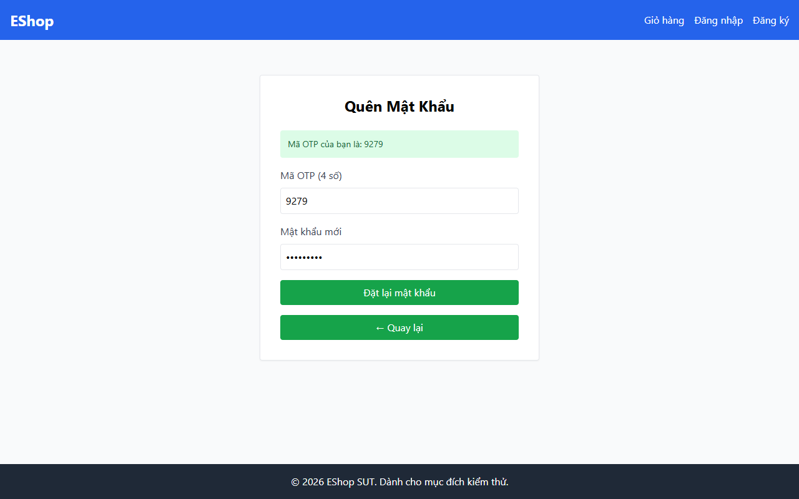

# TC-BVA-COMP-LOWER-002: Số lượng Chữ thường Tại Biên (1 Chữ thường)

## Requirement ID

FR-03 (Bước 2), FR-01

## Module / Test Type / Technique

PASSWORD-RESET-WEB / Functional / BVA

## Preconditions

- Mã OTP hợp lệ đã được tạo cho `test@eshop.com`.

## Test Data

| Field | Value |
|---|---|
| `otp` | `<Mã OTP hợp lệ>` |
| `new_password` | `ABc1234@X` (8 ký tự, chính xác 1 chữ thường: 'c') |
| `confirm_password` | `ABc1234@X` |

## Test Steps

1. Tại Bước 2, nhập mã OTP hợp lệ.
2. Nhập `ABc1234@X` vào trường mật khẩu mới và xác nhận mật khẩu.
3. Nhấn nút gửi.

## Expected Result

- Xác thực mật khẩu vượt qua yêu cầu chữ thường. Đặt lại mật khẩu thành công.

## Actual Result

Mật khẩu có đúng 1 chữ thường và ký tự đặc biệt "pASS123@!" bị regex Client từ chối do chứa ký tự đặc biệt.

**Execution report observation:** Bị Client Regex chặn do chứa ký tự đặc biệt `@!` và thiếu khoảng trắng.

## Evidence

## Test Design Rationale

Kiểm tra số lượng chữ thường chính xác tại ngưỡng tối thiểu (`min = 1`).

## Status / Related Bugs

FAIL / DEF-FR03-05 — see [execution report](../../../reports/test-results/FR-03/bva_testing_report.md).
