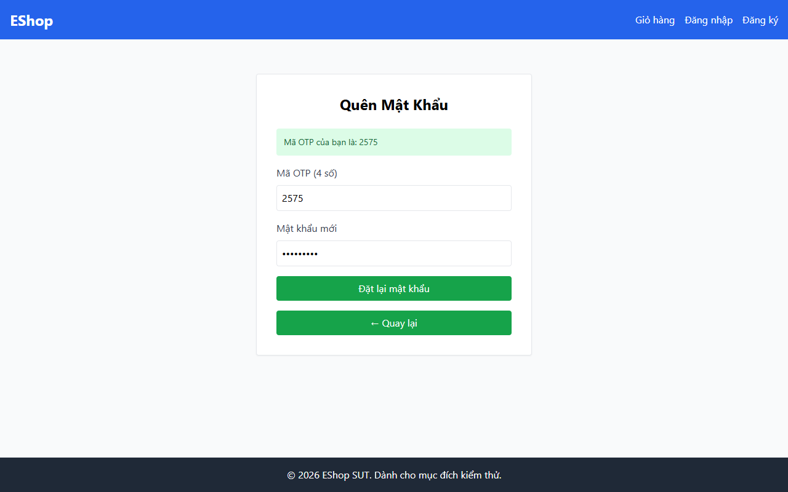

# TC-BVA-COMP-UPPER-001: Số lượng Chữ hoa Dưới Biên (0 Chữ hoa)

## Requirement ID

FR-03 (Bước 2), FR-01

## Module / Test Type / Technique

PASSWORD-RESET-WEB / Functional / BVA

## Preconditions

- Mã OTP hợp lệ đã được tạo cho `test@eshop.com`.

## Test Data

| Field | Value |
|---|---|
| `otp` | `<Mã OTP hợp lệ>` |
| `new_password` | `abc1234@x` (8 ký tự, 0 chữ hoa) |
| `confirm_password` | `abc1234@x` |

## Test Steps

1. Tại Bước 2, nhập mã OTP hợp lệ.
2. Nhập `abc1234@x` vào trường mật khẩu mới và xác nhận mật khẩu.
3. Nhấn nút gửi.

## Expected Result

- Hệ thống từ chối mật khẩu do thiếu ký tự viết hoa (`min = 1`).

## Actual Result

Từ chối mật khẩu 0 chữ hoa ("pass123@!") với alert: "Mật khẩu quá yếu...".

**Execution report observation:** Từ chối chính xác với alert: "Mật khẩu quá yếu!...".

## Evidence

## Test Design Rationale

Kiểm tra biên số lượng chữ hoa dưới ngưỡng (`1 - 1 = 0`).

## Status / Related Bugs

PASS / Không có — see [execution report](../../../reports/test-results/FR-03/bva_testing_report.md).
