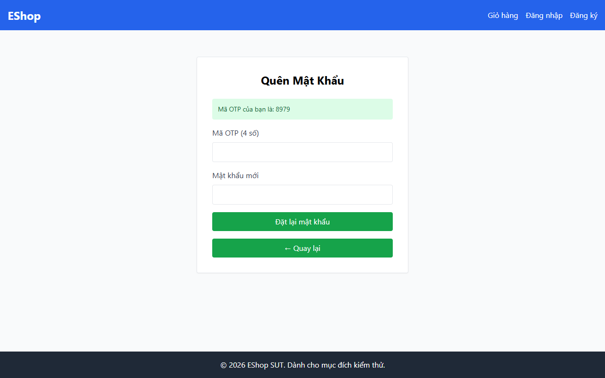

# TC-BVA-MATCH-001: Khớp Xác nhận Mật khẩu (Khoảng cách = 0, Khớp Hoàn toàn)

## Requirement ID

FR-03 (Bước 2)

## Module / Test Type / Technique

PASSWORD-RESET-WEB / Functional / BVA

## Preconditions

- Mã OTP hợp lệ đã được tạo cho `test@eshop.com`.

## Test Data

| Field | Value |
|---|---|
| `otp` | `<Mã OTP hợp lệ>` |
| `new_password` | `Abc123@x` |
| `confirm_password` | `Abc123@x` (Lệch 0 ký tự) |

## Test Steps

1. Tại Bước 2, nhập mã OTP hợp lệ.
2. Nhập `Abc123@x` vào "Mật khẩu mới".
3. Nhập `Abc123@x` vào "Xác nhận mật khẩu mới".
4. Nhấn nút gửi.

## Expected Result

- Hệ thống xác nhận cả hai trường khớp nhau; đặt lại mật khẩu thành công.

## Actual Result

Giao diện Bước 2 thiếu trường "Xác nhận mật khẩu mới"; không có trường dữ liệu để so khớp.

**Execution report observation:** Giao diện Bước 2 thiếu ô "Xác nhận mật khẩu mới" trong cấu trúc DOM.

## Evidence

## Test Design Rationale

Kiểm tra biên đồng nhất chính xác nơi độ lệch giữa hai trường bằng 0.

## Status / Related Bugs

FAIL / DEF-FR03-07 — see [execution report](../../../reports/test-results/FR-03/bva_testing_report.md).
